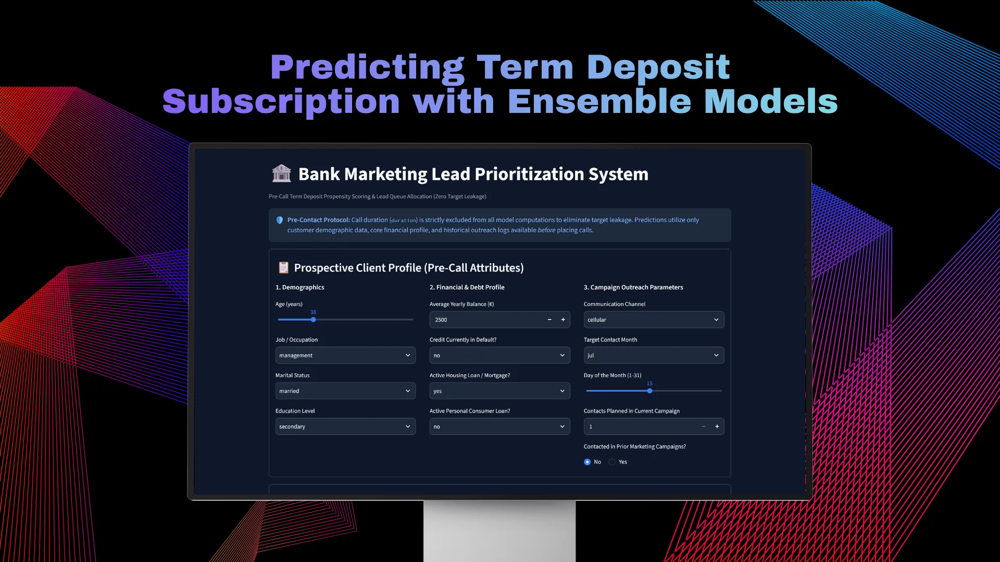
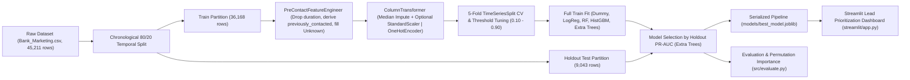

# Predicting Term Deposit Subscription with Ensemble Models




## Project Overview

Predicting Term Deposit Subscription with Ensemble Models is an end-to-end supervised machine learning system built to solve pre-contact lead prioritization for retail bank direct telemarketing campaigns. Trained and validated on 45,211 historical Portuguese banking outreach records from the UCI Machine Learning Repository, the system estimates whether a prospective customer will subscribe to a term deposit (`y` = `yes` or `no`) using only demographic, financial, and campaign history attributes observable before an outbound call is placed. By strictly excluding the post-call `duration` attribute and validating on a chronological 80/20 temporal holdout split with 5-fold time-series cross-validation, the pipeline eliminates target leakage, accounts for macroeconomic concept drift, and serves calibrated lead priority scores through a serialized Scikit-Learn pipeline and interactive Streamlit dashboard.

## Problem Statement & Objectives

Direct telemarketing remains a core customer acquisition channel for retail bank term deposits, yet unguided outbound calling suffers from severe class imbalance—only 11.70% of historical contacts resulted in a subscription—leading to wasted call-center agent hours and customer contact fatigue. Standard retrospective models that retain call `duration` appear artificially accurate during offline evaluation but cannot operate prior to dialing, while randomized train-test splits conceal temporal shifts in campaign targeting and conversion rates.

The project pursues the following verified objectives:

- Formulate a pre-contact binary classification pipeline that predicts `P(y = 'yes' | x_pre)` strictly without post-call target leakage (`duration` excluded).
- Handle severe class imbalance (~7.5:1 overall ratio, and 6.73% positive rate in the early training period) via balanced class weighting and validation-driven probability threshold calibration.
- Respect chronological ordering by evaluating all candidate models on an 80/20 temporal holdout split (`36,168` training rows vs. `9,043` holdout test rows) supported by inner 5-fold `TimeSeriesSplit` cross-validation.
- Benchmark candidate classifiers—Dummy baseline, Logistic Regression, Random Forest, HistGradientBoosting, and Extra Trees—against both a post-contact leakage benchmark and a stratified random-split benchmark.
- Quantify pre-contact predictive drivers through model-agnostic permutation feature importance on the temporal holdout set.
- Package the winning Scikit-Learn pipeline into `models/best_model.joblib` and expose real-time pre-call lead scoring in an interactive Streamlit web interface ([streamlit/app.py](streamlit/app.py)).

## Data & Input Sources

The modeling pipeline consumes the UCI Bank Marketing dataset stored in [dataset/original/Bank_Marketing.csv](dataset/original/Bank_Marketing.csv) with schema metadata documented in [metadata.json](metadata.json) and [dataset/original/metadata.json](dataset/original/metadata.json). Programmatic inspection via [src/data_audit.py](src/data_audit.py) confirms 45,211 unique contact records (0 duplicate rows) collected across 30 consecutive monthly campaign blocks from May 2008 to November 2010, exhibiting strong temporal concept drift between the first 80% of rows (6.73% subscription rate) and the final 20% (31.58% subscription rate).

| Attribute | Description |
| :--- | :--- |
| Dataset / Input Source | UCI Bank Marketing Dataset (UCI ID: 222; DOI: `10.24432/C5K306`) |
| Source | [dataset/original/Bank_Marketing.csv](dataset/original/Bank_Marketing.csv), [metadata.json](metadata.json) |
| Format | CSV (tabular text) |
| Samples / Records | 45,211 records (36,168 chronological train / 9,043 chronological test; 0 duplicates) |
| Features / Input Shape | 16 raw input columns (15 pre-contact predictors + 1 excluded post-contact `duration` column) |
| Target / Label | `y` — binary term deposit subscription (`no`: 39,922 / 88.30%; `yes`: 5,289 / 11.70%) |

## Data Preprocessing & Feature Engineering

All preprocessing and feature engineering logic is encapsulated inside `PreContactFeatureEngineer` and `ColumnTransformer` pipelines in [src/preprocessing.py](src/preprocessing.py), ensuring transformations are fitted exclusively on training folds without data leakage. Missing values appear only in four categorical columns (`poutcome`: 81.75%, `contact`: 28.80%, `education`: 4.11%, `job`: 0.64%) and are retained as an explicit `'Unknown'` category rather than dropping rows, while `pdays == -1` (81.74% of records, 100% consistent with `previous == 0`) is converted into a dedicated `previously_contacted` indicator.

| Transformation | Input Features | Output / Behavior |
| :--- | :--- | :--- |
| Leakage Guard (`PreContactFeatureEngineer`) | Raw DataFrame (`16` predictors) | Drops `duration` when `exclude_duration=True` (15 pre-contact columns retained) |
| Prior Contact Indicator | `pdays` | Creates binary `previously_contacted` (`1` if `pdays != -1`, else `0`) |
| Categorical Imputation | 9 categorical columns (`job`, `marital`, `education`, `default`, `housing`, `loan`, `contact`, `month`, `poutcome`) | Fills `NaN` with explicit `'Unknown'` string prior to encoding |
| Numeric Imputation & Optional Scaling | 7 numeric columns (`age`, `balance`, `day_of_week`, `campaign`, `pdays`, `previous`, `previously_contacted`) | Median `SimpleImputer`, followed by `StandardScaler` when `include_scaling=True` (used for Logistic Regression) |
| Categorical Encoding | 9 categorical columns | `OneHotEncoder(handle_unknown='ignore', sparse_output=False)` |

Preprocessing execution sequence inside `build_full_pipeline`:

1. `PreContactFeatureEngineer.transform` drops `duration` (for all pre-contact models), computes `previously_contacted = (pdays != -1).astype(int)`, and replaces missing categorical entries with `'Unknown'`.
2. `ColumnTransformer` routes the 7 numeric features through median imputation (and `StandardScaler` for linear models) and routes the 9 categorical features through `OneHotEncoder(handle_unknown='ignore')`, dropping any unmapped remainder columns.
3. The transformed dense feature matrix is passed directly into the downstream Scikit-Learn classifier estimator.

## Tech Stack

| Category | Technology | Purpose |
| :--- | :--- | :--- |
| Programming Language | Python | Core scripting, modeling pipeline, and application runtime |
| ML & Preprocessing | Scikit-Learn | `Pipeline`, `ColumnTransformer`, `TimeSeriesSplit`, ensemble/linear classifiers, metrics, and permutation importance |
| Data Manipulation | Pandas, NumPy | Tabular ingestion, chronological slicing, feature derivation, and threshold grid search |
| Statistical Utilities | SciPy | Underlying scientific computation support |
| Visualization | Matplotlib, Seaborn | Exploratory plots, ROC/PR curves, threshold trade-off curves, confusion matrices, and feature importance charts |
| Model Serialization | Joblib | Serializing and loading the production `models/best_model.joblib` pipeline |
| Interactive Dashboard | Streamlit | Pre-contact lead scoring UI and queue tier assignment ([streamlit/app.py](streamlit/app.py)) |
| Imaging Dependency | Pillow | Image handling dependency declared in [requirements.txt](requirements.txt) |
| Development Notebook | Jupyter Notebook | Exploratory workflow documentation ([notebooks/bank_marketing_exploration.ipynb](notebooks/bank_marketing_exploration.ipynb)) |

## Machine Learning Approach

The project addresses an imbalanced binary classification problem over time-ordered tabular banking records using supervised ensemble and linear learning methods. Because the dataset is ordered chronologically from May 2008 to November 2010 and exhibits substantial campaign targeting drift, the workflow rejects random shuffling in favor of causal temporal splitting, class-weighted training, PR-AUC–centered model selection, and out-of-fold F1 threshold calibration.

| Attribute | Value |
| :--- | :--- |
| Learning Paradigm | Supervised Learning |
| Problem Domain | Retail Banking Direct Telemarketing |
| ML Task | Binary Classification (Pre-Contact Lead Scoring) |
| Input | 15 pre-contact demographic, financial, and campaign attributes |
| Target / Output | Binary subscription label `y` (`0`/`1`) and calibrated probability `P(y = 'yes' | x_pre)` |
| Validation Approach | 80/20 chronological temporal holdout + 5-fold `TimeSeriesSplit` CV + leakage & random-split benchmarks |

## Model Overview

Five candidate estimators were implemented inside identical preprocessing pipelines in [src/train.py](src/train.py), with **Extra Trees Classifier** selected as the champion model based on achieving the highest Precision-Recall AUC (`0.4907`) on the temporal holdout test set.

| Model | Role | Algorithm / Family | Scaling Applied | Pretrained Status |
| :--- | :--- | :--- | :--- | :--- |
| Extra Trees (`ExtraTreesClassifier`) | Champion Model (Selected) | Randomized Tree Bagging Ensemble | No | Trained from scratch in project |
| Random Forest (`RandomForestClassifier`) | Ensemble Candidate | Bootstrap Tree Bagging Ensemble | No | Trained from scratch in project |
| HistGradientBoosting (`HistGradientBoostingClassifier`) | Ensemble Candidate & Benchmark Base | Histogram-Based Gradient Boosting | No | Trained from scratch in project |
| Logistic Regression (`LogisticRegression`) | Linear Baseline | L2-Regularized Generalized Linear Model | Yes (`StandardScaler`) | Trained from scratch in project |
| Dummy Classifier (`DummyClassifier`) | Uninformative Baseline | Majority-Class (`most_frequent`) Predictor | No | Fitted on training target frequency |

## ML Workflow

The implemented pipeline spans six modular stages across [src/](src), [streamlit/app.py](streamlit/app.py), [notebooks/bank_marketing_exploration.ipynb](notebooks/bank_marketing_exploration.ipynb), and [final_report.md](final_report.md):

1. **Data Quality & Temporal Structure Audit** ([src/data_audit.py](src/data_audit.py)): Inspects `Bank_Marketing.csv` and `metadata.json`, validates binary target values, quantifies missing categorical counts, verifies `day_of_week` (calendar day 1–31) and `pdays == -1` semantics, confirms 30 monthly blocks, and exports [audit_summary.json](audit_summary.json).
2. **Exploratory Data Analysis** ([src/eda.py](src/eda.py)): Generates 7 diagnostic PNG charts in `figures/` covering target imbalance, missingness, numeric distributions, categorical subscription rates, target-stratified boxplots, Spearman correlations, and rolling temporal concept drift.
3. **Leakage-Free Preprocessing Pipeline** ([src/preprocessing.py](src/preprocessing.py)): Constructs `PreContactFeatureEngineer` and `ColumnTransformer` inside `build_full_pipeline` to drop `duration`, engineer `previously_contacted`, impute missing values, and encode categorical predictors.
4. **Chronological Training, Time-Series CV & Benchmarking** ([src/train.py](src/train.py)): Splits data 80/20 chronologically, runs 5-fold `TimeSeriesSplit` for out-of-fold F1 threshold tuning (`0.10` to `0.90`), fits all five pre-contact candidates plus Post-Contact and Random-Split benchmarks, selects the top PR-AUC model, and writes [models/best_model.joblib](models/best_model.joblib), [models/metrics_summary.json](models/metrics_summary.json), and `models/plot_data.json`.
5. **Evaluation, Visualization & Permutation Importance** ([src/evaluate.py](src/evaluate.py)): Produces 6 model evaluation plots in `figures/` and computes 5-repeat permutation feature importance (ROC-AUC decrease) on the temporal holdout set, saving results to [models/permutation_importance.json](models/permutation_importance.json).
6. **Interactive Pre-Contact Lead Scoring** ([streamlit/app.py](streamlit/app.py)): Loads [models/best_model.joblib](models/best_model.joblib) and scores user-entered lead profiles against the calibrated `0.49` threshold, assigning High (`>= 60%`), Medium (`49%–59%`), or Low (`< 49%`) outbound queue tiers.

## ML Pipeline Architecture

The end-to-end architecture enforces strict separation between pre-contact feature transformation, time-ordered validation, serialized artifact export, and interactive inference. Chronological rows first enter the custom `PreContactFeatureEngineer`, pass through branch-specific `ColumnTransformer` imputation and encoding, and feed into 5-fold `TimeSeriesSplit` threshold calibration before final training and holdout evaluation.



## Model Training & Configuration

All models in [src/train.py](src/train.py) are trained on the first 80% chronological partition (`36,168` rows; `2,433` positive cases, `6.73%` positive rate) using `random_state=42` and balanced class weighting (`class_weight="balanced"`) where supported. For each model, 5-fold `TimeSeriesSplit` generates out-of-fold validation probabilities, which are swept across 81 evenly spaced thresholds from `0.10` to `0.90` (`np.linspace(0.10, 0.90, 81)`) to select the threshold maximizing validation F1-score before refitting on 100% of the training split.

| Model | Configured Hyperparameters | Class Balancing & Scaling | Optimal CV Threshold | Training + CV Time |
| :--- | :--- | :--- | :---: | :---: |
| Dummy (Baseline) | `strategy="most_frequent"` | None; no scaling | `0.50` | `0.74 s` |
| Logistic Regression | `max_iter=1000`, `random_state=42` (default L2 penalty) | `class_weight="balanced"`; `StandardScaler` | `0.55` | `1.32 s` |
| Random Forest | `n_estimators=200`, `max_depth=12`, `min_samples_split=10`, `min_samples_leaf=4`, `n_jobs=-1`, `random_state=42` | `class_weight="balanced"`; no scaling | `0.50` | `4.09 s` |
| HistGradientBoosting | `max_iter=150`, `learning_rate=0.08`, `min_samples_leaf=20`, `random_state=42` | `class_weight="balanced"`; no scaling | `0.55` | `2.95 s` |
| Extra Trees (Champion) | `n_estimators=200`, `max_depth=12`, `min_samples_split=10`, `min_samples_leaf=4`, `n_jobs=-1`, `random_state=42` | `class_weight="balanced"`; no scaling | `0.49` | `3.83 s` |

```python
ExtraTreesClassifier(
    n_estimators=200,
    max_depth=12,
    min_samples_split=10,
    min_samples_leaf=4,
    class_weight="balanced",
    random_state=42,
    n_jobs=-1,
)
```

## Model Comparison & Selection

Model comparison in [src/train.py](src/train.py) contrasts five pre-contact candidates on the chronological holdout test set (`N = 9,043`; positive prevalence = `31.58%`) and benchmarks the clean pre-contact pipeline against two methodological controls using `HistGradientBoostingClassifier`. While `Logistic Regression` achieves higher raw recall at `0.50` (`0.7759`) at the expense of low specificity (`0.4332`), and `Random Forest` edges out F1 (`0.5393`) and Balanced Accuracy (`0.6429`) at `0.50`, **Extra Trees** is selected as the champion model because it achieves the highest **PR-AUC (`0.4907`)**—representing a +17.49 percentage-point lift over the `0.3158` no-skill prevalence baseline—with strong specificity (`0.6063` at `0.50`).

| Model / Benchmark | Split Protocol | Duration Included | PR-AUC | ROC-AUC | Balanced Acc | F1-Score | Recall | Precision | Specificity |
| :--- | :--- | :---: | :---: | :---: | :---: | :---: | :---: | :---: | :---: |
| Dummy (Baseline) (`th=0.50`) | Temporal 80/20 | No | `0.3158` | `0.5000` | `0.5000` | `0.0000` | `0.0000` | `0.0000` | `1.0000` |
| Logistic Regression (`th=0.50`) | Temporal 80/20 | No | `0.4889` | `0.6850` | `0.6045` | `0.5166` | `0.7759` | `0.3872` | `0.4332` |
| Random Forest (`th=0.50`) | Temporal 80/20 | No | `0.4713` | `0.6837` | `0.6429` | `0.5393` | `0.7024` | `0.4377` | `0.5835` |
| HistGradientBoosting (`th=0.50`) | Temporal 80/20 | No | `0.4781` | `0.6818` | `0.6367` | `0.5330` | `0.6950` | `0.4322` | `0.5785` |
| **Extra Trees (Champion, `th=0.50`)** | Temporal 80/20 | No | **`0.4907`** | `0.6817` | `0.6351` | `0.5275` | `0.6639` | `0.4377` | `0.6063` |
| Post-Contact Benchmark (`HistGBM`, `th=0.50`) | Temporal 80/20 | **Yes (Leakage)** | `0.5565` | `0.7914` | `0.6746` | `0.5532` | `0.5420` | `0.5648` | `0.8072` |
| Random-Split Benchmark (`HistGBM`, `th=0.50`) | Stratified Random 80/20 | No | `0.4655` | `0.8023` | `0.7383` | `0.4536` | `0.6276` | `0.3551` | `0.8490` |

## Model Artifacts & Checkpoints

All serialized model pipelines, audit outputs, and evaluation telemetry generated by the scripts are stored locally in the repository under `models/` and the project root.

| Artifact | Format | Purpose | Location |
| :--- | :--- | :--- | :--- |
| Champion Fitted Pipeline | Joblib | End-to-end `PreContactFeatureEngineer`, `ColumnTransformer`, and `ExtraTreesClassifier` pipeline | [models/best_model.joblib](models/best_model.joblib) |
| Training & Evaluation Summary | JSON | Temporal split statistics, 5-fold CV results, holdout test metrics, and methodological benchmarks | [models/metrics_summary.json](models/metrics_summary.json) |
| Permutation Feature Importance | JSON | Mean and standard deviation of ROC-AUC decrease across 5 permutations per feature | [models/permutation_importance.json](models/permutation_importance.json) |
| Curve Plotting Telemetry | JSON | Ground-truth holdout labels and predicted probability arrays for all models and benchmarks | `models/plot_data.json` |
| Data Audit Summary | JSON | Dataset shape, duplicate check, missing value counts, and split class proportions | [audit_summary.json](audit_summary.json) |

## Model Evaluation & Results

Evaluation on the chronological holdout test set (`N = 9,043`, comprising `2,856` subscribers and `6,187` non-subscribers) demonstrates clear distinction between training-period CV scores and out-of-sample test performance. During 5-fold `TimeSeriesSplit` CV on the early training cohort (`6.73%` positive rate), `Extra Trees` recorded a mean CV PR-AUC of `0.0924`, ROC-AUC of `0.5243`, and F1 of `0.1353`, whereas on the later temporal holdout cohort (`31.58%` positive rate) it achieved a test PR-AUC of `0.4907` and ROC-AUC of `0.6817`. Applying the CV-calibrated optimal decision threshold (`0.49`) increases subscriber recall from `66.39%` to `69.08%` (`1,973` true positives captured out of `2,856`).

| Evaluation Split & Threshold (Extra Trees) | PR-AUC | ROC-AUC | Balanced Accuracy | F1-Score | F2-Score | Recall | Precision | Specificity | Accuracy |
| :--- | :---: | :---: | :---: | :---: | :---: | :---: | :---: | :---: | :---: |
| 5-Fold `TimeSeriesSplit` CV (Mean) | `0.0924` | `0.5243` | — | `0.1353` | — | — | — | — | — |
| Temporal Holdout Test (`th = 0.50`) | `0.4907` | `0.6817` | `0.6351` | `0.5275` | `0.6017` | `0.6639` | `0.4377` | `0.6063` | `0.6245` |
| Temporal Holdout Test (`th = 0.49`, Optimal CV) | `0.4907` | `0.6817` | `0.6343` | `0.5303` | `0.6162` | `0.6908` | `0.4303` | `0.5778` | `0.6135` |

Key evaluation findings and verified limitations:

- **Confusion Matrix at `th = 0.49`:** `1,973` True Positives, `3,575` True Negatives, `2,612` False Positives, and `883` False Negatives (`4,585` leads flagged for outreach out of `9,043`, capturing `69.08%` of conversions while suppressing `49.3%` of total calling volume).
- **Leakage Impact:** Including `duration` inflates `HistGradientBoosting` holdout ROC-AUC from `0.6818` to `0.7914` and PR-AUC from `0.4781` to `0.5565`, confirming why post-call attributes cannot be used for pre-call scoring.
- **Temporal Concept Drift:** The positive class rate shifts from `6.73%` in the training slice to `31.58%` in the holdout slice alongside increased re-contact of prior leads, meaning model probabilities require periodic drift monitoring and recalibration.
- **Channel Missingness:** Over `28.80%` of records lack a known communication channel (`contact = 'Unknown'`), and external macroeconomic indicators (such as interest rates) are not present in this dataset variant.

## Model Explainability & Interpretability

Model-agnostic **Permutation Feature Importance** (`sklearn.inspection.permutation_importance`) was executed in [src/evaluate.py](src/evaluate.py) on the full chronological holdout test set using `scoring='roc_auc'`, `n_repeats=5`, and `random_state=42`. Results saved in [models/permutation_importance.json](models/permutation_importance.json) show that prior campaign outcome (`poutcome`), contact month (`month`), and housing loan status (`housing`) drive the majority of pre-contact discrimination, while `duration` records `0.0000` importance because it is explicitly dropped inside `PreContactFeatureEngineer`. The generated bar chart visualization is stored in `figures/feature_importance.png`.

| Feature | Mean ROC-AUC Decrease | Std Deviation | Observed Role in Pre-Contact Model |
| :--- | :---: | :---: | :--- |
| `poutcome` | `0.0801` | `0.0020` | Strongest pre-contact predictor; prior campaign outcome heavily separates repeat subscribers |
| `month` | `0.0207` | `0.0031` | Captures seasonal campaign scheduling effects across the 30-month horizon |
| `housing` | `0.0170` | `0.0018` | Indicates whether the customer carries an active housing mortgage obligation |
| `marital` | `0.0107` | `0.0031` | Reflects household financial structure differences across marital statuses |
| `contact` | `0.0093` | `0.0010` | Differentiates cellular, telephone, and `'Unknown'` outreach channels |
| `education` | `0.0073` | `0.0015` | Captures conversion variance across primary, secondary, tertiary, and `'Unknown'` tiers |
| `loan` | `0.0071` | `0.0013` | Reflects active personal consumer loan commitments |
| `day_of_week` | `0.0044` | `0.0010` | Represents calendar day of the month (`1`–`31`) for contact timing |

## Results Visualization & Preview

No additional non-banner `.webp` preview images are available in `screenshots/` beyond `screenshots/banner.webp`. All 13 pipeline-generated EDA and model evaluation figures (target distribution, missing values, numeric distributions, categorical subscription rates, numeric-by-target boxplots, correlation heatmap, temporal trend, model comparison, ROC curves, precision-recall curves, threshold trade-off, confusion matrices, and permutation feature importance) are saved as PNG files under `figures/` and analyzed in [final_report.md](final_report.md).

## Prerequisites

The project runs on standard CPU hardware without requiring GPU acceleration or external API keys. Verified software requirements from [requirements.txt](requirements.txt) and [final_report.md](final_report.md) include:

- Python 3.10+
- `pandas==3.1.1`
- `numpy==2.5.4`
- `scikit-learn==1.9.1`
- `scipy==1.18.1`
- `matplotlib==3.11.2`
- `seaborn==0.13.2`
- `joblib==1.6.0`
- `streamlit==1.67.0`
- `pillow==13.0.0`

## Installation & Setup

Follow these steps from the repository root to prepare a local Python environment and install the pinned dependencies:

1. Clone the repository and navigate into the project directory:

```bash
git clone https://github.com/weztcy/Predicting-Term-Deposit-Subscription-with-Ensemble-Models.git
cd "Predicting Term Deposit Subscription with Ensemble Models"
```

2. Create and activate a virtual environment:

```bash
python -m venv .venv
# Windows PowerShell
.venv\Scripts\Activate.ps1
# Linux / macOS
source .venv/bin/activate
```

3. Install the project dependencies from [requirements.txt](requirements.txt):

```bash
pip install -r requirements.txt
```

## Usage & Execution

The project includes modular pipeline scripts under [src/](src) and an interactive pre-contact lead-scoring dashboard in [streamlit/app.py](streamlit/app.py) configured with [`.streamlit/config.toml`](.streamlit/config.toml). Note that [src/data_audit.py](src/data_audit.py), [src/eda.py](src/eda.py), [src/train.py](src/train.py), and [src/evaluate.py](src/evaluate.py) read `Bank_Marketing.csv` from the repository root (or `dataset/Bank_Marketing.csv`), whereas the bundled CSV resides at [dataset/original/Bank_Marketing.csv](dataset/original/Bank_Marketing.csv).

1. Launch the interactive Streamlit lead prioritization dashboard using the pre-trained [models/best_model.joblib](models/best_model.joblib) artifact:

```bash
python -m streamlit run streamlit/app.py
```

2. Optionally inspect the exploratory walkthrough notebook in [notebooks/bank_marketing_exploration.ipynb](notebooks/bank_marketing_exploration.ipynb) using Jupyter.

3. If re-running the audit, EDA, training, or evaluation scripts from the root directory, copy [dataset/original/Bank_Marketing.csv](dataset/original/Bank_Marketing.csv) to `Bank_Marketing.csv` in the project root first, then execute the desired script:

```bash
# Windows PowerShell
Copy-Item "dataset\original\Bank_Marketing.csv" "Bank_Marketing.csv"
python src/data_audit.py
python src/eda.py
python src/train.py
python src/evaluate.py
```

## Reproducibility & Execution

All experiments, splits, threshold sweeps, and permutation importance calculations are deterministic and reproducible using fixed seeds (`random_state=42`) and pinned package versions in [requirements.txt](requirements.txt). Running the pipeline end to end reproduces the serialized model, JSON summaries, and PNG figures without requiring external downloads:

1. Ensure `Bank_Marketing.csv` and `metadata.json` are accessible in the repository root (copying `dataset/original/Bank_Marketing.csv` if not already placed at root).
2. Run `python src/data_audit.py` to regenerate [audit_summary.json](audit_summary.json) and verify the 45,211-row chronological split (`36,168` train / `9,043` holdout test).
3. Run `python src/eda.py` to regenerate the 7 exploratory plots in `figures/`.
4. Run `python src/train.py` to execute the 5-fold `TimeSeriesSplit` CV, sweep thresholds (`0.10`–`0.90` across 81 points), train all 5 candidates plus the 2 benchmarks (`random_state=42`), and overwrite [models/best_model.joblib](models/best_model.joblib), [models/metrics_summary.json](models/metrics_summary.json), and `models/plot_data.json`.
5. Run `python src/evaluate.py` to regenerate the 6 evaluation plots in `figures/` and recompute 5-repeat permutation importance (`random_state=42`) into [models/permutation_importance.json](models/permutation_importance.json).

Inference reproducibility only requires [models/best_model.joblib](models/best_model.joblib) and [requirements.txt](requirements.txt); full training reproducibility relies on identical dataset row ordering in [dataset/original/Bank_Marketing.csv](dataset/original/Bank_Marketing.csv) and matching Scikit-Learn / NumPy versions.

## Contributing

Contributions that improve data validation, drift monitoring, feature engineering, or model calibration are welcome. Please follow this standard workflow:

1. Fork the repository.
2. Create a branch for the change.
3. Make the changes.
4. Run relevant checks or tests when available.
5. Commit and push the branch.
6. Open a pull request with a clear explanation.

## License

This project is licensed under the MIT License.
See the [LICENSE](LICENSE) file for details.

## Author & Contact

**Yohanes Dimas Pratama**

- GitHub: [github.com/weztcy](https://github.com/weztcy)
- Portfolio: [yohanesdimas.com](https://yohanesdimas.com)
- LinkedIn: [linkedin.com/in/yohanes-dimas](https://www.linkedin.com/in/yohanes-dimas)
