# Predicting Term Deposit Subscription with Ensemble Models


## Project Overview

Predicting Term Deposit Subscription with Ensemble Models is an end-to-end supervised machine learning pipeline and interactive lead-scoring application built for retail bank direct telemarketing operations. The system predicts the probability that a prospective banking client will subscribe to a term deposit prior to outbound dialing by strictly excluding post-call variables such as call duration (`duration`). Evaluated on 45,211 chronological telemarketing records from the UCI Bank Marketing dataset, the project addresses severe class imbalance, macroeconomic temporal concept drift, and operational queue prioritization through a serialized Extra Trees pipeline and a dark-mode Streamlit interface.

## Problem Statement & Objectives

Untargeted telemarketing campaigns impose high call-center labor costs, customer fatigue, and missed conversions when only 11.70% of outbound calls result in a term deposit subscription. Furthermore, naive modeling approaches often retain post-contact call duration—which is unknown before a call takes place—or rely on randomized cross-validation that masks temporal distribution shifts between early cold-outreach batches and later re-engagement campaigns.

- **Pre-Contact Binary Classification:** Estimate $P(y = \text{'yes'} \mid \mathbf{x}_{\text{pre}})$ strictly from customer demographics, core financial attributes, and prior outreach history observable before dialing.
- **Zero Target Leakage:** Enforce programmatic exclusion of the post-contact `duration` feature inside the preprocessing transformer while quantifying leakage inflation via controlled benchmark comparisons.
- **Imbalance-Aware Learning & Calibration:** Mitigate the ~7.5:1 overall class skew using balanced class weighting (`class_weight='balanced'`) and out-of-fold decision threshold calibration.
- **Time-Aware Validation:** Preserve chronological causality with an 80/20 temporal holdout split and 5-fold `TimeSeriesSplit` validation rather than randomized splitting.
- **Interpretability & Operational Deployment:** Quantify feature drivers via permutation importance and deliver a serialized model alongside a Streamlit lead prioritization dashboard.

## Data & Input Sources

The project uses the UCI Machine Learning Repository Bank Marketing dataset (`Bank_Marketing.csv`) alongside its structural descriptor (`metadata.json`), stored in [dataset/original/Bank_Marketing.csv](dataset/original/Bank_Marketing.csv) and [dataset/original/metadata.json](dataset/original/metadata.json). The dataset records 45,211 chronologically ordered direct phone marketing contacts conducted by a Portuguese retail bank between May 2008 and November 2010, with zero duplicate rows and four categorical features containing missing (`NaN`) values (`poutcome` 81.75%, `contact` 28.80%, `education` 4.11%, `job` 0.64%).

| Attribute | Description |
| :--- | :--- |
| **Dataset / Input Source** | UCI Bank Marketing Dataset (ID: 222; DOI: `10.24432/C5K306`) |
| **Source** | [dataset/original/Bank_Marketing.csv](dataset/original/Bank_Marketing.csv) & [metadata.json](metadata.json) |
| **Format** | Tabular CSV (`16` candidate predictors + `1` binary target) |
| **Samples / Records** | `45,211` total contacts (`36,168` temporal train / `9,043` temporal holdout test) |
| **Features / Input Shape** | `15` pre-contact raw predictors (`6` numeric, `9` categorical) + `1` engineered flag (`duration` excluded) |
| **Target / Label** | `y` (`no`: `39,922` / `88.30%`, `yes`: `5,289` / `11.70%`) |

## Data Preprocessing & Feature Engineering

All data transformations are encapsulated inside custom scikit-learn transformers in [src/preprocessing.py](src/preprocessing.py) so that training statistics are learned strictly on training folds without data leakage. Semantic auditing in [src/data_audit.py](src/data_audit.py) also verified that `day_of_week` encodes the calendar day of the month (1–31) and that `pdays == -1` corresponds 100.00% with `previous == 0` (no prior contact).

| Transformation Step | Input Columns | Output / Effect |
| :--- | :--- | :--- |
| **Anti-Leakage Feature Drop** | `duration` | Dropped inside `PreContactFeatureEngineer` when `exclude_duration=True` |
| **Prior Contact Indicator** | `pdays` | Binary feature `previously_contacted` (`1` if `pdays != -1`, else `0`) |
| **Missing Category Imputation** | `job`, `marital`, `education`, `default`, `housing`, `loan`, `contact`, `month`, `poutcome` | `NaN` values explicitly filled with `'Unknown'` and cast to string |
| **Numeric Imputation & Scaling** | `age`, `balance`, `day_of_week`, `campaign`, `pdays`, `previous`, `previously_contacted` | Median `SimpleImputer`; optional `StandardScaler` enabled for Logistic Regression |
| **Categorical Encoding** | `9` categorical attributes | `OneHotEncoder(handle_unknown='ignore', sparse_output=False)` |

1. Pass raw DataFrame inputs through `PreContactFeatureEngineer` to remove `duration`, derive `previously_contacted`, and impute missing categorical values as `'Unknown'`.
2. Route numeric columns (including `previously_contacted`) and categorical columns through a `ColumnTransformer` (`build_preprocessor`).
3. Apply median imputation (and standard scaling when `include_scaling=True`) to numeric features while one-hot encoding categorical attributes with unknown-category protection.
4. Combine preprocessing and estimator stages into a single end-to-end scikit-learn `Pipeline` via `build_full_pipeline`.

## Tech Stack

| Category | Technology | Purpose |
| :--- | :--- | :--- |
| **Language** | Python | Core scripting, modeling pipelines, and web application logic |
| **ML Framework** | Scikit-learn | Ensemble classifiers, pipelines, `TimeSeriesSplit`, metrics, and permutation importance |
| **Data Processing** | Pandas, NumPy, SciPy | Tabular ingestion, temporal slicing, numerical arrays, and statistical auditing |
| **Visualization** | Matplotlib, Seaborn | Exploratory charts, ROC/PR curves, confusion matrices, and threshold plots |
| **Model Serialization** | Joblib | Persisting and loading the trained `best_model.joblib` inference pipeline |
| **Web Application** | Streamlit, Pillow | Interactive dark-mode pre-contact lead scoring and priority queue dashboard |
| **Interactive Analysis** | Jupyter Notebook | Exploratory workflow documentation in `notebooks/bank_marketing_exploration.ipynb` |

## Machine Learning Approach

The problem is formulated as imbalanced supervised binary classification under chronological temporal drift. Instead of standard stratified random splitting—which mixes 2008–2010 campaign regimes and yields an overly optimistic ROC-AUC of 0.8023—the pipeline enforces causal ordering with an 80/20 chronological split and evaluates multiple linear, bagging, and boosting model families using precision-recall area under the curve (PR-AUC) as the primary selection criterion.

| Attribute | Implementation Detail |
| :--- | :--- |
| **Learning Paradigm** | Supervised Learning |
| **Problem Domain** | Retail Banking & Direct Telemarketing Lead Prioritization |
| **ML Task** | Binary Classification (`yes` vs `no` term deposit subscription) |
| **Input Representation** | 15 pre-contact CRM, demographic, debt, and campaign history features + 1 binary indicator |
| **Target / Output** | Calibrated subscription probability $P(y = \text{'yes'} \mid \mathbf{x}_{\text{pre}})$ and binary action tier |
| **Validation Strategy** | 80/20 chronological temporal holdout (`36,168` / `9,043`) + 5-fold `TimeSeriesSplit` |

## Model Overview

Five candidate classifiers are trained and evaluated on identical pre-contact features (`exclude_duration=True`) within end-to-end scikit-learn pipelines, alongside two diagnostic benchmark configurations (`Post-Contact` with `duration` and `Random-Split` without `duration`) to empirically verify leakage and temporal drift impacts. All models are trained from scratch on the project dataset; no external pretrained weights are used.

| Model Candidate | Algorithm Family | Pipeline Scaling | Role in Project |
| :--- | :--- | :--- | :--- |
| **Extra Trees** | Extremely Randomized Trees Ensemble | No | Champion model (`models/best_model.joblib`) selected by highest holdout PR-AUC |
| **Random Forest** | Bagging Decision Tree Ensemble | No | Nonlinear bagging comparator (highest holdout F1 and Balanced Accuracy) |
| **HistGradientBoosting** | Histogram-Based Gradient Boosting | No | Boosting comparator and base estimator for leakage/split benchmarks |
| **Logistic Regression** | L2-Regularized Linear Classifier | Yes (`StandardScaler`) | Interpretable linear baseline (highest holdout ROC-AUC and default-threshold recall) |
| **Dummy Classifier** | Majority-Class (`most_frequent`) | No | Uninformative no-skill baseline establishing holdout prevalence (`31.58%`) |

## ML Workflow

The end-to-end workflow is organized into modular Python scripts and documented in [final_report.md](final_report.md) and [notebooks/bank_marketing_exploration.ipynb](notebooks/bank_marketing_exploration.ipynb):

1. **Data Quality & Temporal Auditing:** Validate schema, duplicate counts, missingness, `pdays`/`previous` consistency, `day_of_week` semantics, and chronological month blocks via [src/data_audit.py](src/data_audit.py), writing [audit_summary.json](audit_summary.json).
2. **Exploratory Data Analysis (EDA):** Generate distribution, target imbalance, categorical conversion rate, Spearman correlation, and rolling temporal drift figures into `figures/` using [src/eda.py](src/eda.py).
3. **Leakage-Free Preprocessing Pipeline:** Construct `PreContactFeatureEngineer` and `ColumnTransformer` pipelines inside [src/preprocessing.py](src/preprocessing.py) to exclude `duration` and encode pre-contact features.
4. **Temporal Splitting, Training & Calibration:** Partition the dataset 80/20 chronologically, run 5-fold `TimeSeriesSplit` CV, sweep thresholds in `[0.10, 0.90]` to maximize F1, train final pipelines, run leakage/split benchmarks, and export `models/best_model.joblib`, [models/metrics_summary.json](models/metrics_summary.json), and `models/plot_data.json` via [src/train.py](src/train.py).
5. **Holdout Evaluation & Permutation Explainability:** Generate model comparison, confusion matrix, ROC, Precision-Recall, threshold trade-off, and permutation importance plots plus [models/permutation_importance.json](models/permutation_importance.json) via [src/evaluate.py](src/evaluate.py).
6. **Interactive Lead Scoring UI:** Serve real-time pre-contact lead scoring and priority tier assignment (`High`, `Medium`, `Low`) through [streamlit/app.py](streamlit/app.py).

## ML Pipeline Architecture

The architecture connects raw CSV ingestion through chronological partitioning, leakage-guarded preprocessing, time-series cross-validation, holdout evaluation, and serialized deployment in the Streamlit application.

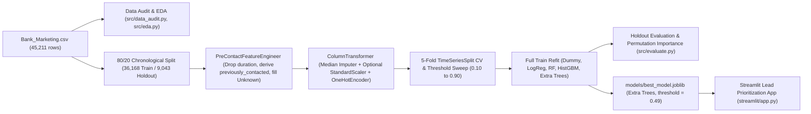

## Model Training & Configuration

Models are trained from scratch in [src/train.py](src/train.py) on the first 36,168 chronological records (`6.73%` positive rate) and tested on the final 9,043 records (`31.58%` positive rate). All stochastic estimators fix `random_state=42` and apply `class_weight="balanced"` to counter class imbalance.

| Estimator | Key Hyperparameters | Scaling | Training Time (incl. 5-Fold CV) |
| :--- | :--- | :--- | :--- |
| **Dummy (Baseline)** | `strategy="most_frequent"` | False | `0.74 s` |
| **Logistic Regression** | `class_weight="balanced"`, `max_iter=1000`, `random_state=42` | True | `1.32 s` |
| **Random Forest** | `n_estimators=200`, `max_depth=12`, `min_samples_split=10`, `min_samples_leaf=4`, `class_weight="balanced"`, `n_jobs=-1`, `random_state=42` | False | `4.09 s` |
| **HistGradientBoosting** | `class_weight="balanced"`, `max_iter=150`, `learning_rate=0.08`, `min_samples_leaf=20`, `random_state=42` | False | `2.95 s` |
| **Extra Trees (Champion)** | `n_estimators=200`, `max_depth=12`, `min_samples_split=10`, `min_samples_leaf=4`, `class_weight="balanced"`, `n_jobs=-1`, `random_state=42` | False | `3.83 s` |

```python
ExtraTreesClassifier(
    n_estimators=200,
    max_depth=12,
    min_samples_split=10,
    min_samples_leaf=4,
    class_weight="balanced",
    random_state=42,
    n_jobs=-1,
)
```

## Hyperparameter Tuning & Experiment Tracking

Decision threshold optimization is performed inside [src/train.py](src/train.py) using out-of-fold probability estimates from 5-fold `TimeSeriesSplit` on the training set (`find_optimal_threshold` evaluating `81` thresholds across `np.linspace(0.10, 0.90, 81)` for maximum F1-score). Experiment metrics, cross-validation averages, confusion matrices, and test probability arrays are tracked as structured JSON artifacts in [models/metrics_summary.json](models/metrics_summary.json) and `models/plot_data.json`.

| Model | Mean CV F1 | Mean CV ROC-AUC | Mean CV PR-AUC | Optimal CV Threshold |
| :--- | :---: | :---: | :---: | :---: |
| **Dummy (Baseline)** | `0.0000` | `0.5000` | `0.0744` | `0.50` |
| **Logistic Regression** | `0.1504` | `0.5408` | `0.0954` | `0.55` |
| **Random Forest** | `0.1389` | `0.5346` | `0.0944` | `0.50` |
| **HistGradientBoosting** | `0.1329` | `0.5347` | `0.0917` | `0.55` |
| **Extra Trees** | `0.1353` | `0.5243` | `0.0924` | `0.49` |

## Model Comparison & Selection

Candidate selection compares all non-dummy pre-contact models on the chronological holdout test set (`N = 9,043`, positive prevalence `31.58%`) using default `0.50` threshold PR-AUC, alongside two diagnostic benchmarks demonstrating why excluding `duration` and preserving chronological splits are mandatory. **Extra Trees** is selected as the champion model with the highest holdout **PR-AUC (`0.4907`)**, delivering a `+17.49` percentage-point lift over the `0.3158` no-skill baseline.

| Experiment / Model | Split Type | PR-AUC | ROC-AUC | Balanced Acc | F1-Score | Recall | Precision | Specificity |
| :--- | :--- | :---: | :---: | :---: | :---: | :---: | :---: | :---: |
| **Dummy (Baseline)** | Temporal 80/20 | `0.3158` | `0.5000` | `0.5000` | `0.0000` | `0.0000` | `0.0000` | `1.0000` |
| **Logistic Regression** (`0.50`) | Temporal 80/20 | `0.4889` | `0.6850` | `0.6045` | `0.5166` | `0.7759` | `0.3872` | `0.4332` |
| **Random Forest** (`0.50`) | Temporal 80/20 | `0.4713` | `0.6837` | `0.6429` | `0.5393` | `0.7024` | `0.4377` | `0.5835` |
| **HistGradientBoosting** (`0.50`) | Temporal 80/20 | `0.4781` | `0.6818` | `0.6367` | `0.5330` | `0.6950` | `0.4322` | `0.5785` |
| **Extra Trees (Selected, `0.50`)** | Temporal 80/20 | `0.4907` | `0.6817` | `0.6351` | `0.5275` | `0.6639` | `0.4377` | `0.6063` |
| **Post-Contact HistGBM (With `duration`)** | Temporal 80/20 | `0.5565` | `0.7914` | `0.6746` | `0.5532` | `0.5420` | `0.5648` | `0.8072` |
| **Random-Split HistGBM (No `duration`)** | Stratified Random | `0.4655` | `0.8023` | `0.7383` | `0.4536` | `0.6276` | `0.3551` | `0.8490` |

## Model Artifacts & Checkpoints

All serialized model binaries, experiment summaries, and diagnostic outputs are generated directly by the project training and evaluation scripts into `models/` and root audit outputs.

| Artifact Name | Format | Purpose | Location |
| :--- | :--- | :--- | :--- |
| **Champion Pipeline** | `.joblib` | End-to-end fitted `PreContactFeatureEngineer`, `ColumnTransformer`, and `ExtraTreesClassifier` | `models/best_model.joblib` |
| **Metrics Summary** | `.json` | Temporal split stats, 5-fold CV results, holdout evaluations, and benchmark metrics | [models/metrics_summary.json](models/metrics_summary.json) |
| **Permutation Importance** | `.json` | Mean and std ROC-AUC decrease across 5 permutations per raw predictor | [models/permutation_importance.json](models/permutation_importance.json) |
| **Curve Plot Data** | `.json` | Holdout ground truth labels and model predicted probability arrays for plotting | `models/plot_data.json` |
| **Data Audit Summary** | `.json` | Row counts, missingness statistics, `pdays` consistency, and drift proportions | [audit_summary.json](audit_summary.json) |

## Model Evaluation & Results

On the chronological holdout test set (`N = 9,043`, comprising `2,856` subscribers and `6,187` non-subscribers), applying the CV-calibrated optimal threshold (`0.49`) to the champion **Extra Trees** pipeline improves recall from `66.39%` to `69.08%` (`1,973` true positives captured vs `883` false negatives) while keeping precision at `43.03%` (`2,612` false positives, `3,575` true negatives) and eliminating `49.3%` of total outbound calling volume (`4,585` leads contacted out of `9,043`).

| Metric | Extra Trees (`threshold = 0.50`) | Extra Trees (`optimal threshold = 0.49`) | Holdout Reference / Baseline |
| :--- | :---: | :---: | :--- |
| **PR-AUC** | `0.4907` | `0.4907` | `0.3158` (Dummy no-skill prevalence) |
| **ROC-AUC** | `0.6817` | `0.6817` | `0.5000` (Random chance) |
| **Recall (Sensitivity)** | `0.6639` | `0.6908` | `0.0000` (Dummy baseline) |
| **Precision** | `0.4377` | `0.4303` | `0.3158` (Unguided dialing rate) |
| **F1-Score** | `0.5275` | `0.5303` | `0.0000` (Dummy baseline) |
| **F2-Score** | `0.6017` | `0.6162` | `0.0000` (Dummy baseline) |
| **Balanced Accuracy** | `0.6351` | `0.6343` | `0.5000` (Dummy baseline) |
| **Specificity** | `0.6063` | `0.5778` | `1.0000` (Dummy predicts all `'no'`) |
| **Accuracy** | `0.6245` | `0.6135` | `0.6842` (Dummy majority-class accuracy) |

- **Temporal Drift Impact:** Training rows (May 2008 – early 2010) average a `6.73%` subscription rate whereas the holdout test window rises to `31.58%` due to a surge in previously contacted leads (`10.56%` to `49.09%`), explaining lower raw CV scores (`0.0924` CV PR-AUC) relative to holdout PR-AUC (`0.4907`).
- **Leakage Demonstration:** Retaining post-call `duration` inflates HistGradientBoosting ROC-AUC from `0.6818` to `0.7914` and PR-AUC from `0.4781` to `0.5565`, confirming why `duration` must remain excluded for pre-contact scoring.
- **Limitations:** Over `28.80%` of records lack `contact` channel metadata, external macroeconomic indicators (such as Euribor rates) are absent from the dataset, and subpopulation shift requires periodic monitoring and retraining.

## Model Explainability & Interpretability

Model-agnostic permutation feature importance was computed in [src/evaluate.py](src/evaluate.py) on the chronological holdout test set using `roc_auc` scoring with `n_repeats=5` (`random_state=42`), saved to [models/permutation_importance.json](models/permutation_importance.json). Prior campaign outcome (`poutcome`) is the dominant pre-contact driver, while `duration` records `0.0000` importance because it is explicitly dropped inside `PreContactFeatureEngineer`.

| Rank | Feature | Mean ROC-AUC Decrease | Std Deviation | Interpreted Modeling Role |
| :---: | :--- | :---: | :---: | :--- |
| **1** | `poutcome` | `0.0801` | `0.0020` | Strongest pre-contact predictor; prior campaign success strongly increases conversion odds |
| **2** | `month` | `0.0207` | `0.0031` | Captures seasonal campaign peaks (March, September, October, December) |
| **3** | `housing` | `0.0170` | `0.0018` | Mortgage obligation reduces disposable liquidity available for term deposits |
| **4** | `marital` | `0.0107` | `0.0031` | Differentiates household financial priorities across single, married, and divorced leads |
| **5** | `contact` | `0.0093` | `0.0010` | Cellular outreach achieves higher contactability and conversion than unknown channels |
| **6** | `education` | `0.0073` | `0.0015` | Higher education segments correlate with stronger fixed-income deposit uptake |
| **7** | `loan` | `0.0071` | `0.0013` | Personal consumer loans reduce surplus capital for term deposit allocation |
| **8** | `day_of_week` | `0.0044` | `0.0010` | Monthly calendar contact timing aligns with customer liquidity cycles |

## Results Visualization & Preview

### 1. Streamlit Lead Prioritization Interface — Pre-Call Client Profile Form
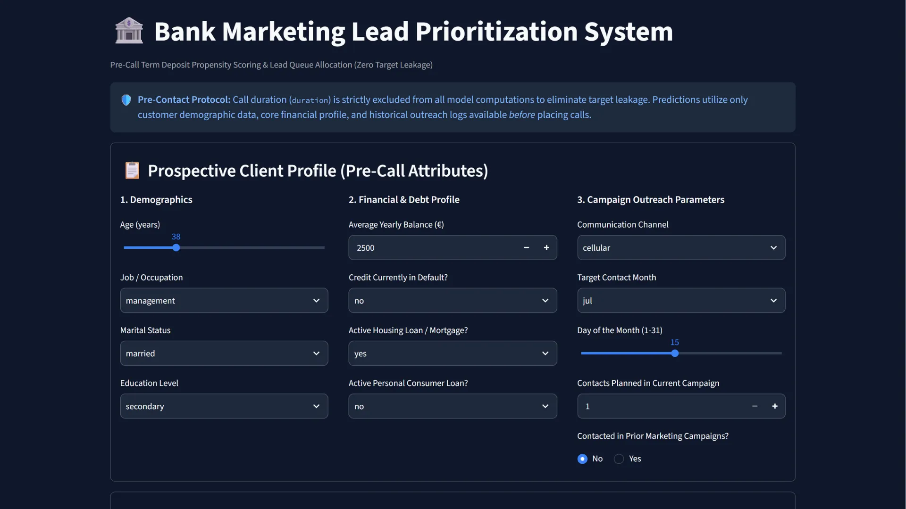
The upper workspace of the dark-mode Streamlit application displaying the Pre-Contact Protocol anti-leakage banner and a three-column input form covering customer demographics, financial and debt profile, and campaign outreach parameters without any call duration field.

### 2. Streamlit Lead Prioritization Interface — Propensity Scoring & Queue Allocation
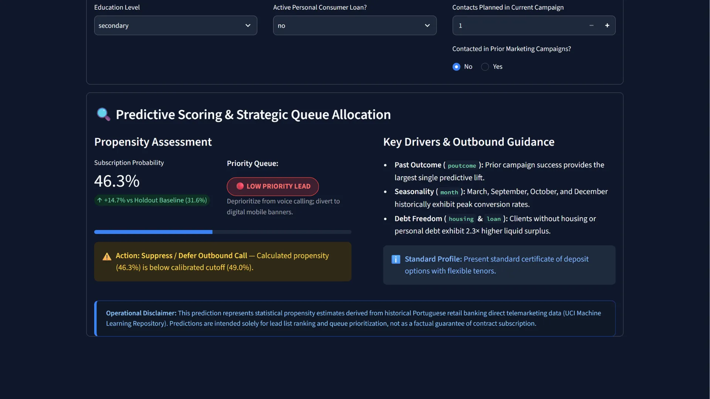
The lower prediction panel showing real-time Extra Trees propensity output (`46.3%`, `+14.7%` vs the `31.6%` holdout baseline), operational priority badge classification against the calibrated `49.0%` cutoff, tailored sales guidance, and the governance disclaimer.

### 3. Chronological Rolling Subscription Rate & Monthly Campaign Drift
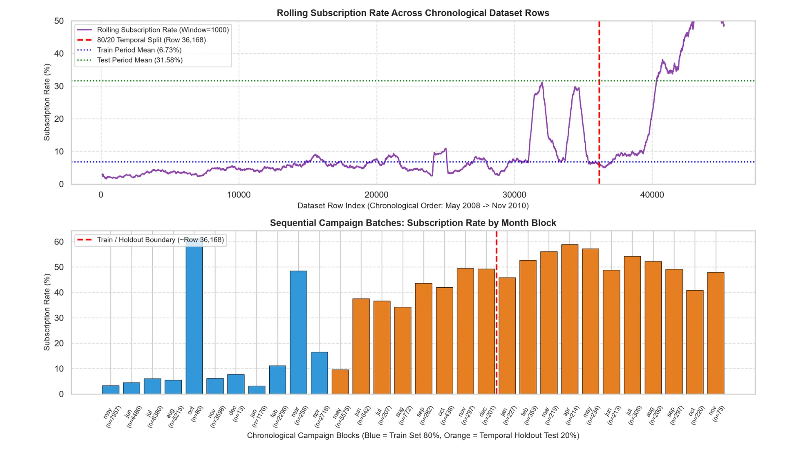
Rolling 1,000-row subscription trend and sequential monthly campaign block chart confirming severe temporal concept drift across the 30-month horizon, where the training period averages `6.73%` subscriptions before surging to `31.58%` in the final 20% holdout window.

### 4. Distributions of Key Pre-Contact Numeric Features
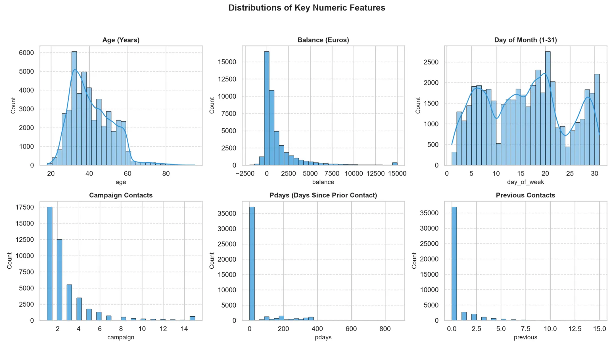
Six-panel histogram grid profiling `age`, `balance`, `day_of_week`, `campaign`, `pdays`, and `previous`, illustrating strong right-skew in account balances and current campaign contact counts alongside the large zero/uncontacted spike in prior outreach variables.

### 5. Permutation Feature Importance & Decision Threshold Trade-Off Curves
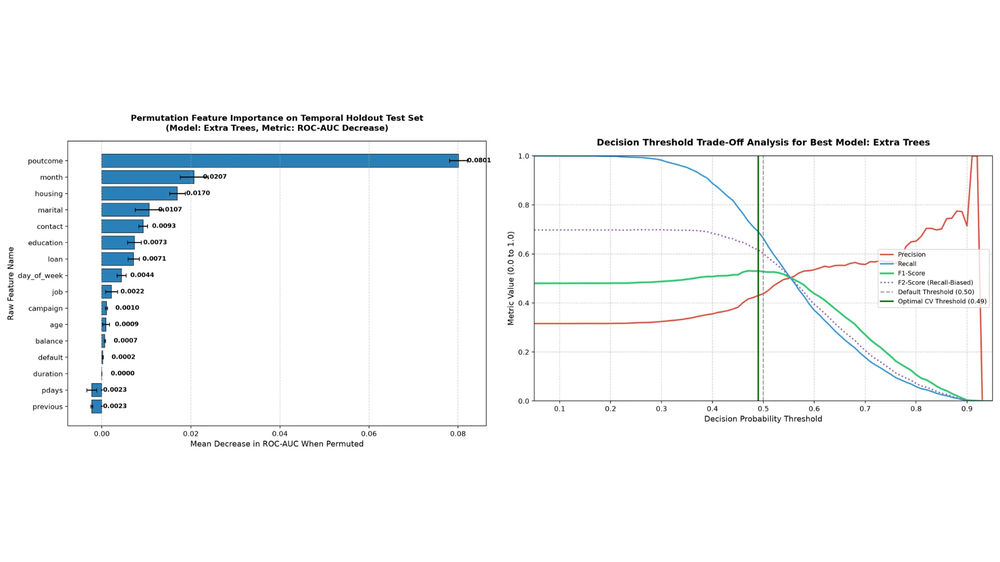
Two-panel diagnostic figure combining holdout ROC-AUC permutation importance for Extra Trees (led by `poutcome` at `0.0801`, `month` at `0.0207`, and `housing` at `0.0170`) with precision, recall, F1, and F2 curves identifying the optimal CV threshold at `0.49`.

### 6. Term Deposit Subscription Rates Across Categorical Segments
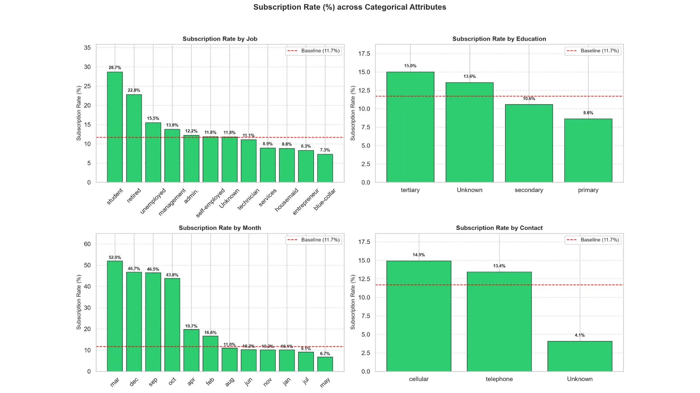
Four-panel categorical conversion chart showing elevated subscription rates among students (`28.7%`), retirees (`22.8%`), tertiary-educated leads (`15.0%`), cellular contacts (`14.9%`), and high-yield campaign months (`mar` `52.0%`, `dec` `46.7%`, `sep` `46.5%`, `oct` `43.8%`) relative to the `11.7%` baseline.

### 7. ROC & Precision-Recall Curve Comparisons Against Leakage Benchmarks
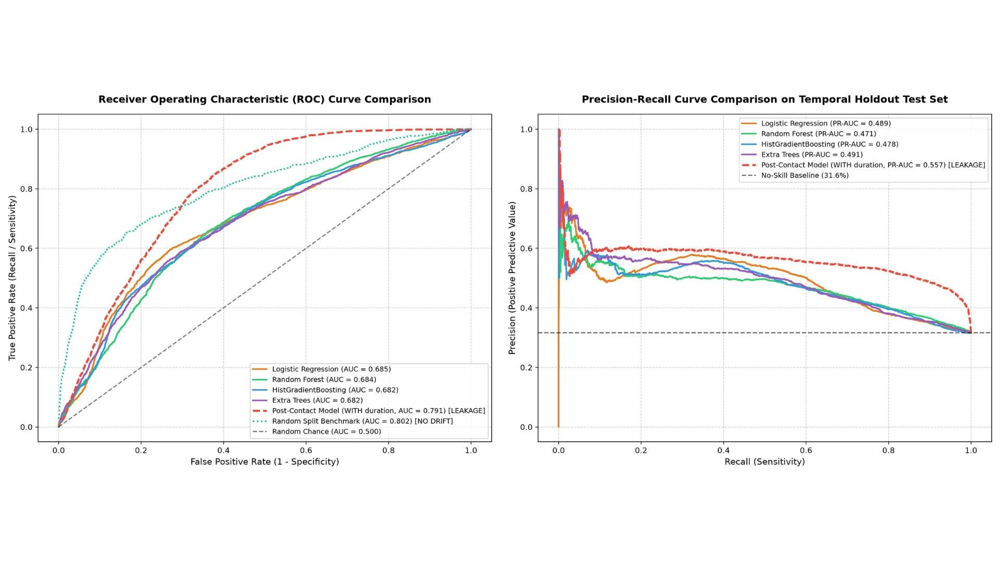
Side-by-side ROC and Precision-Recall curves on the temporal holdout set contrasting pre-contact models (`ROC-AUC` `0.682`–`0.685`, Extra Trees `PR-AUC` `0.491`) against the inflated Post-Contact leakage benchmark (`ROC-AUC` `0.791`, `PR-AUC` `0.557`) and Random Split benchmark (`ROC-AUC` `0.802`).

### 8. Missing Value Audit & Overall Target Class Imbalance
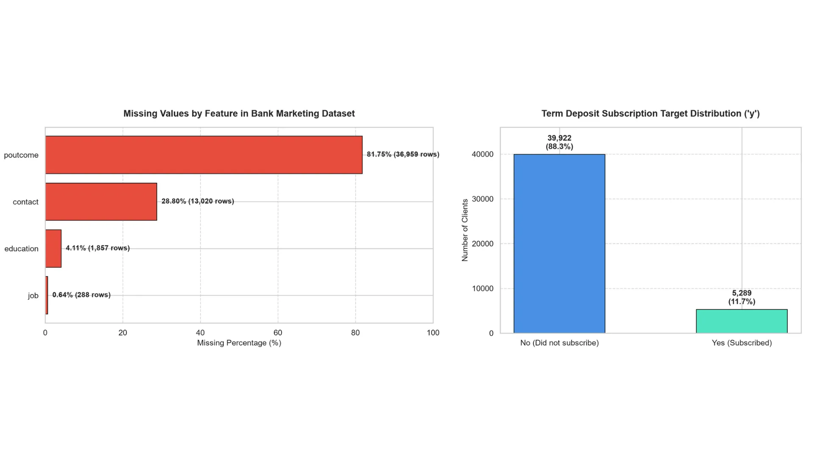
Data audit summary charting missingness across four categorical columns (`poutcome` `81.75%`, `contact` `28.80%`, `education` `4.11%`, `job` `0.64%`) alongside the overall target class skew (`39,922` non-subscribers at `88.3%` versus `5,289` subscribers at `11.7%`).

### 9. Numeric Feature Boxplots Stratified by Subscription Outcome
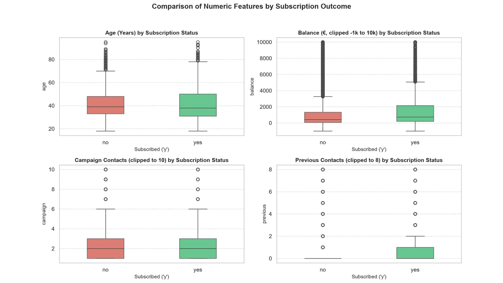
Four-panel boxplot comparison of `age`, clipped `balance`, `campaign`, and `previous` split by target class `y`, showing higher median account balances and more prior contacts among term deposit subscribers.

### 10. Numeric Correlation Heatmap, Model Comparison & Extra Trees Confusion Matrices
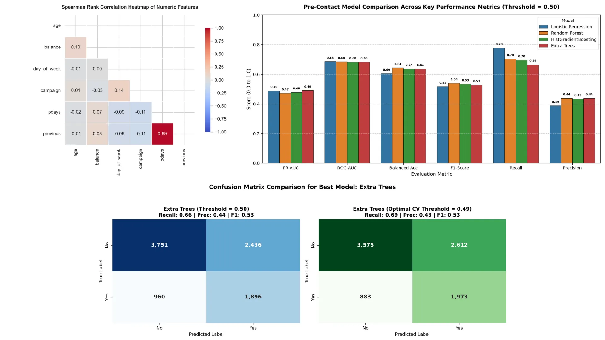
Consolidated evaluation view displaying the Spearman numeric correlation matrix (`0.99` between `pdays` and `previous`), six-metric model comparison at threshold `0.50`, and Extra Trees confusion matrices comparing default `0.50` (`1,896` TP) against calibrated `0.49` (`1,973` TP).

## Prerequisites

- **Python:** Python 3.10+ (CPU execution supported; `n_jobs=-1` uses available CPU cores for tree ensembles and permutation importance)
- **Package Manager:** `pip`
- **Core Dependencies (from [requirements.txt](requirements.txt)):** `pandas==3.1.1`, `numpy==2.5.4`, `scikit-learn==1.9.1`, `scipy==1.18.1`, `matplotlib==3.11.2`, `seaborn==0.13.2`, `joblib==1.6.0`, `streamlit==1.67.0`, `pillow==13.0.0`
- **Dataset Access:** Local CSV file included in the repository at [dataset/original/Bank_Marketing.csv](dataset/original/Bank_Marketing.csv)

## Installation & Setup

1. Clone the repository and navigate to the project root directory:
   ```bash
   git clone https://github.com/weztcy/Predicting-Term-Deposit-Subscription-with-Ensemble-Models.git
   cd "Predicting Term Deposit Subscription with Ensemble Models"
   ```
2. Create and activate a Python virtual environment:
   ```bash
   python -m venv .venv
   # Windows PowerShell
   .\.venv\Scripts\Activate.ps1
   # Linux/macOS
   source .venv/bin/activate
   ```
3. Install pinned dependencies from [requirements.txt](requirements.txt):
   ```bash
   pip install -r requirements.txt
   ```
4. Note for script path resolution: `src/eda.py` reads `Bank_Marketing.csv` from the project root and `src/data_audit.py` / `src/train.py` / `src/evaluate.py` check `Bank_Marketing.csv` or `dataset/Bank_Marketing.csv`, whereas the repository stores the raw data under `dataset/original/Bank_Marketing.csv`. Copy `dataset/original/Bank_Marketing.csv` (and `dataset/original/metadata.json` if needed) to the project root before re-running training/audit scripts:
   ```bash
   # Windows PowerShell
   Copy-Item "dataset\original\Bank_Marketing.csv" ".\Bank_Marketing.csv"
   ```

## Usage & Execution

The repository already ships pre-generated model artifacts (`models/best_model.joblib`, [models/metrics_summary.json](models/metrics_summary.json)) and diagnostic figures (`figures/`), so the interactive Streamlit scoring app can be launched immediately or after re-running the pipeline scripts.

1. Launch the interactive Streamlit lead-scoring dashboard ([streamlit/app.py](streamlit/app.py)):
   ```bash
   python -m streamlit run streamlit/app.py
   ```
2. Enter a prospective client's pre-contact demographic, financial, and campaign history parameters in the web form to inspect the predicted subscription probability, priority queue tier (`HIGH >= 60%`, `MEDIUM >= 49%`, `LOW < 49%`), and outbound sales guidance.
3. Optionally open [notebooks/bank_marketing_exploration.ipynb](notebooks/bank_marketing_exploration.ipynb) in Jupyter to inspect interactive exploratory and modeling cells.

## Model Deployment & Serving

Operational inference is served locally via a Streamlit web application configured with a custom dark theme in [.streamlit/config.toml](.streamlit/config.toml) and application logic in [streamlit/app.py](streamlit/app.py).

1. `load_model()` caches `models/best_model.joblib` via `@st.cache_resource` to serve low-latency probability predictions (`pipeline.predict_proba(input_df)[0, 1]`).
2. User inputs are constrained strictly to the 15 pre-contact fields (`duration` is absent from the UI), and predictions are evaluated against the calibrated operational cutoff (`0.49`) and high-priority tier (`0.60`).
3. Start the headless server with the repository configuration using:
   ```bash
   python -m streamlit run streamlit/app.py
   ```

## Reproducibility & Execution

All experiments can be reproduced deterministically using the pinned dependency versions in [requirements.txt](requirements.txt), fixed `random_state=42` seeds across model estimators, `TimeSeriesSplit(n_splits=5)`, stratified benchmark splits, and permutation importance (`n_repeats=5`), and the unmodified UCI dataset ([dataset/original/Bank_Marketing.csv](dataset/original/Bank_Marketing.csv)).

1. Ensure `Bank_Marketing.csv` is present in the project root (copied from `dataset/original/Bank_Marketing.csv`).
2. Run the four pipeline stages sequentially from the repository root:
   ```bash
   python src/data_audit.py
   python src/eda.py
   python src/train.py
   python src/evaluate.py
   ```
3. Verify regenerated artifacts in `audit_summary.json`, `figures/`, `models/best_model.joblib`, `models/metrics_summary.json`, `models/permutation_importance.json`, and `models/plot_data.json`. Note that wall-clock training times in `metrics_summary.json` depend on host CPU core count (`n_jobs=-1`).

## Contributing

Contributions are welcome to improve preprocessing, model calibration, or evaluation diagnostics. Please follow this standard workflow:

1. Fork the repository.
2. Create a feature or fix branch for the change.
3. Make the changes while preserving pre-contact anti-leakage guarantees.
4. Run relevant pipeline checks (`src/data_audit.py`, `src/train.py`, `src/evaluate.py`) and verify the Streamlit app.
5. Commit and push the branch.
6. Open a pull request with a clear explanation of the changes.

## License

This project is licensed under the MIT License.
See the [LICENSE](LICENSE) file for details.

## Author & Contact

**Yohanes Dimas Pratama**

- GitHub: [github.com/weztcy](https://github.com/weztcy)
- Portfolio: [yohanesdimas.com](https://yohanesdimas.com)
- LinkedIn: [linkedin.com/in/yohanes-dimas](https://www.linkedin.com/in/yohanes-dimas)
