# Final Report: Predicting Term Deposit Subscription with Ensemble Models

**Project Title:** Predicting Term Deposit Subscription with Ensemble Models  
**Domain:** Retail Banking / Direct Telemarketing  
**Target Variable:** `y` — Binary indicator of term deposit subscription (`yes` / `no`)  
**Primary Analytical Paradigm:** Pre-Contact Lead Prioritization (Strictly excluding call `duration` to prevent target leakage)  
**Author:** AI Data Science Agent  
**Date of Execution:** November 2026  

---

## 1. Title and Project Overview

Direct telemarketing remains a pivotal acquisition channel for retail banks seeking to expand their long-term retail deposit base. However, cold telephone outreach suffers from diminishing returns, high operational overhead, and customer contact fatigue when conducted via untargeted or indiscriminate calling lists.

This project delivers an end-to-end, scientifically validated, reproducible machine learning system designed to solve the **Pre-Contact Customer Prioritization Problem**. The core operational objective is to score and rank prospective banking leads *before* telemarketing representatives pick up the phone, enabling campaign managers to focus scarce agent hours on high-propensity prospects.

Unlike legacy modeling efforts that inadvertently include in-call metrics, this project strictly adheres to operational reality by **eliminating target leakage**, **handling severe class imbalance**, and evaluating performance using a **chronological temporal holdout** rather than conventional randomized cross-validation.

---

## 2. Executive Summary

A comprehensive diagnostic and modeling pipeline was executed on the full Portuguese retail bank telemarketing dataset comprising 45,211 direct contact records collected between May 2008 and November 2010.

### Key Executive Highlights:
1. **Target Leakage Remediation:** The call duration feature (`duration`) was strictly expunged from the primary modeling feature space. Incorporating call duration artificially inflates model performance (ROC-AUC 0.7914 vs. 0.6817) because conversation length is only knowable *after* an interaction concludes. Its removal ensures that the production model is 100% operationally deployable before outbound dialing.
2. **Identification of Macroeconomic Concept Drift:** Temporal auditing revealed that the dataset is strictly ordered chronologically. Evaluating on an 80/20 temporal split exposed severe concept drift: early campaign batches (May 2008 – early 2010) had an average subscription rate of only **6.73%** (primarily cold acquisitions), whereas later batches (mid to late 2010) achieved **31.58%** due to aggressive re-engagement of previously contacted leads (previous contact rate jumped from 10.56% to 49.09%).
3. **Champion Model Selection:** Among evaluated architectures (Dummy baseline, Logistic Regression, Random Forest, HistGradientBoosting, and Extra Trees), **Extra Trees Classifier** achieved the strongest discriminative capability on the temporal holdout test set with a **PR-AUC of 0.4907** (a +17.49 percentage-point lift over the 31.58% no-skill prevalence baseline) and an **ROC-AUC of 0.6817**.
4. **Calibrated Decision Thresholding:** At the tuned optimal threshold of $\tau = 0.49$, Extra Trees captured **69.08% of all true subscribers** (Recall = 0.6908, 1,973 successful conversions identified) with an overall precision of 43.03%, yielding an F1-score of 0.5303 and Balanced Accuracy of 0.6343. For extreme recall requirements, Logistic Regression captured **77.59%** of subscribers at threshold 0.50.
5. **Top Predictive Drivers:** Permutation feature importance identified previous marketing outcome (`poutcome`), contact month (`month`), housing loan obligations (`housing`), and communication medium (`contact`) as the primary pre-contact determinants of conversion.
6. **Deployment Asset:** A production-ready scikit-learn pipeline was serialized (`models/best_model.joblib`), accompanied by an interactive Streamlit lead-scoring application (`app.py`) for branch and call center operations.

---

## 3. Problem Statement and Objectives

### 3.1 Business Context & Friction Points
Retail banks rely on term deposits (certificates of deposit) to secure stable, low-cost capital reserves necessary for regulatory compliance (e.g., Basel III liquidity ratios) and lending operations. In the analyzed Portuguese banking institution, telemarketing campaigns were deployed across thousands of prospective clients. However, only 11.70% of calls resulted in a signed term deposit. 

The costs of unguided calling are substantial:
- **Direct Labor Waste:** Bank call center representatives spend hundreds of hours pitching uninterested consumers.
- **Brand Erosion & Fatigue:** Excessive or unsolicited cold calls alienate consumers and diminish cross-selling receptivity.
- **Opportunity Loss:** High-propensity clients remain uncontacted while representatives exhaust time on low-yield contacts.

### 3.2 Formal Analytical Objectives
1. **Binary Classification Formulation:** Predict the conditional probability $P(y = \text{'yes'} \mid \mathbf{x}_{\text{pre}})$, where $\mathbf{x}_{\text{pre}}$ represents customer attributes observable prior to outbound dialing.
2. **Strict Pre-Contact Feasibility:** Guarantee zero target leakage by disqualifying post-call variables (`duration`).
3. **Imbalance-Aware Learning:** Address the ~7.5:1 class skew using balanced class weighting and threshold calibration.
4. **Time-Aware Validation:** Respect temporal causality via chronological train-test partitioning and time-series cross-validation.
5. **Model Interpretability:** Isolate and communicate the structural drivers of lead conversion to commercial leadership.
6. **Operational Tooling:** Deliver an end-to-end serialized pipeline and an interactive dashboard for simulated lead scoring.

---

## 4. Dataset Description

The project utilizes the official UCI Machine Learning Repository Bank Marketing benchmark dataset (`Bank_Marketing.csv`), documented in `metadata.json`.

- **Source:** UCI Machine Learning Repository (Dataset ID: 222; DOI: 10.24432/C5K306)
- **Originating Institution:** Portuguese Retail Bank (Directorate of Marketing & Commercial Management)
- **Time Horizon:** May 2008 to November 2010 (30 consecutive months)
- **Observations ($N$):** 45,211 unique contact instances
- **Features ($P$):** 16 candidate predictors + 1 binary target (`y`)
- **Duplicate Rows:** 0 identical rows detected

### Feature Dictionary

| Variable | Type | Measurement Unit / Domain | Operational Availability | Role in Modeling |
| :--- | :--- | :--- | :--- | :--- |
| `age` | Numeric | Age in completed years (18–95) | Pre-Contact (CRM profile) | Included |
| `job` | Categorical | 12 occupational sectors (e.g., admin, blue-collar, management) | Pre-Contact (CRM profile) | Included |
| `marital` | Categorical | Marital status: `married`, `single`, `divorced` | Pre-Contact (CRM profile) | Included |
| `education` | Categorical | Education level: `primary`, `secondary`, `tertiary` | Pre-Contact (CRM profile) | Included |
| `default` | Binary | Credit currently in default (`yes`, `no`) | Pre-Contact (Credit bureau) | Included |
| `balance` | Numeric | Average annual balance in Euros (€) | Pre-Contact (Internal core ledger) | Included |
| `housing` | Binary | Active housing/mortgage loan (`yes`, `no`) | Pre-Contact (Loan department) | Included |
| `loan` | Binary | Active personal consumer loan (`yes`, `no`) | Pre-Contact (Loan department) | Included |
| `contact` | Categorical | Communication channel: `cellular`, `telephone` | Pre-Contact (Telephony channel) | Included |
| `day_of_week` | Numeric | Calendar day of month (1–31) | Pre-Contact (Scheduling date) | Included |
| `month` | Categorical | Month of contact (`jan` through `dec`) | Pre-Contact (Campaign scheduling) | Included |
| `duration` | Numeric | Call duration in seconds (0–4,918 s) | **POST-CONTACT ONLY** | **EXCLUDED (Leakage)** |
| `campaign` | Numeric | Number of contacts in current campaign (1–63) | Pre-Contact (Outreach history) | Included |
| `pdays` | Numeric | Days since prior campaign contact (-1 = never) | Pre-Contact (Campaign CRM log) | Included |
| `previous` | Numeric | Contacts performed before current campaign (0–275) | Pre-Contact (Campaign CRM log) | Included |
| `poutcome` | Categorical | Outcome of prior campaign (`success`, `failure`, `other`) | Pre-Contact (Campaign CRM log) | Included |
| `y` | Binary | Subscribed term deposit (`yes`, `no`) | Outcome Variable | **Target** |

---

## 5. Data Quality Assessment

A programmatic data audit (`src/data_audit.py`) confirmed data integrity and highlighted key nuances:

### 5.1 Verification of Target Variable
The target column `y` contains exactly two unique values: `no` (39,922 observations, 88.30%) and `yes` (5,289 observations, 11.70%). No illegal characters, invalid whitespace, or corrupt values exist in the target column.

### 5.2 Missing Values Breakdown
Missing values in the raw dataset appear as `NaN` values across four categorical features:
- `poutcome`: 36,959 missing values (**81.75%**).
- `contact`: 13,020 missing values (**28.80%**).
- `education`: 1,857 missing values (**4.11%**).
- `job`: 288 missing values (**0.64%**).

All numeric variables (`age`, `balance`, `day_of_week`, `duration`, `campaign`, `pdays`, `previous`) have **0% missing values**.

Instead of listwise row deletion (which would discard over 85% of the data), all missing categorical values are systematically encoded with the explicit label `'Unknown'`. In telemarketing operations, "Unknown" contact channel or prior outcome carries distinct diagnostic meaning rather than being purely missing at random.

```
+-------------------------------------------------------------------------+
|                       MISSING VALUES AUDIT CHART                        |
+-------------------------------------------------------------------------+
```
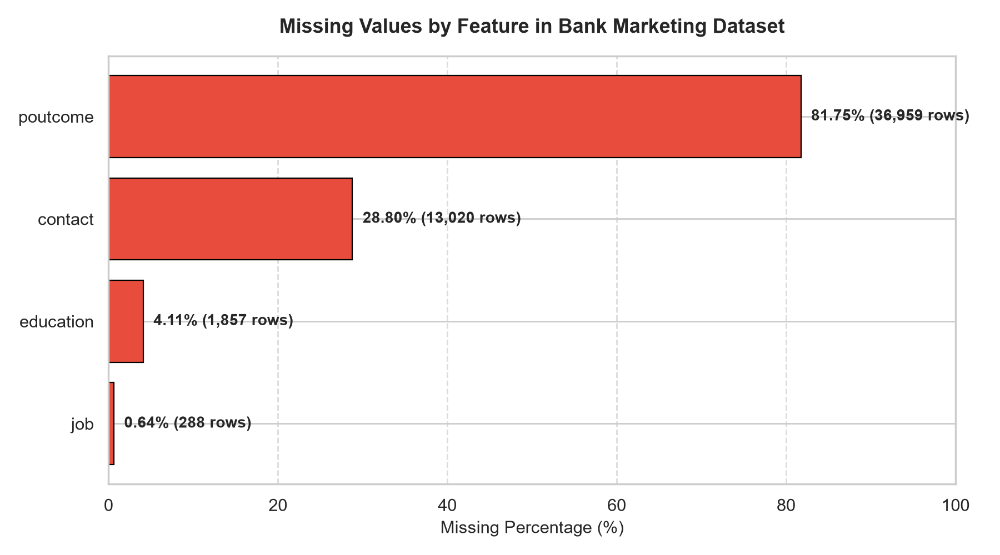

### 5.3 Semantic Nuance: `day_of_week` vs. `day`
In `metadata.json`, variable 10 is described as `day` (last contact day of the month, numeric 1–31). In `Bank_Marketing.csv`, the column header is named `day_of_week`. A thorough distribution audit revealed values strictly bounded between 1 and 31. Hence, `day_of_week` is verified to be the **calendar day of the month**, not day-of-week (Monday–Sunday).

### 5.4 Semantic Nuance: Special Value `pdays = -1`
In `pdays`, the integer `-1` represents clients who were never contacted in prior marketing initiatives. Exactly 36,954 rows (81.74%) have `pdays == -1`. Cross-referencing against `previous == 0` demonstrates a **100.00% exact consistency**: every client with `pdays == -1` has `previous == 0`. Rather than treating `-1` as missing, a dedicated binary feature indicator `previously_contacted` was engineered ($1$ if `pdays != -1`, else $0$).

---

## 6. Exploratory Data Analysis (EDA)

Exploratory analysis yielded crucial insights into lead behavior and campaign dynamics:

### 6.1 Class Imbalance
The target distribution displays substantial skew. Only 1 out of every 8.5 customers agreed to subscribe to the term deposit.

```
+-------------------------------------------------------------------------+
|                       TARGET DISTRIBUTION CHART                         |
+-------------------------------------------------------------------------+
```
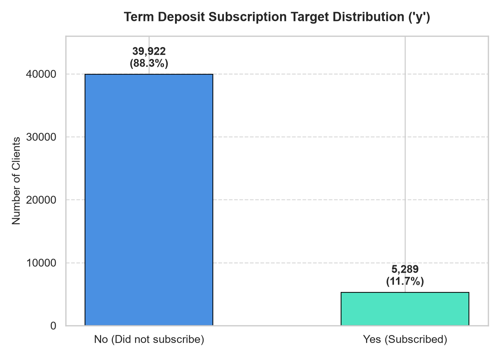

### 6.2 Distributions of Key Numeric Features
- **Age:** Centered around 30–45 years old, with long positive right tails extending to 95.
- **Balance:** Heavily right-skewed with extreme outliers (€100k+) and negative balances down to -€8,099. The median balance is €448.
- **Campaign Contacts:** Rapidly decays; most clients are contacted 1 to 3 times.

```
+-------------------------------------------------------------------------+
|                     NUMERIC FEATURE DISTRIBUTIONS                       |
+-------------------------------------------------------------------------+
```
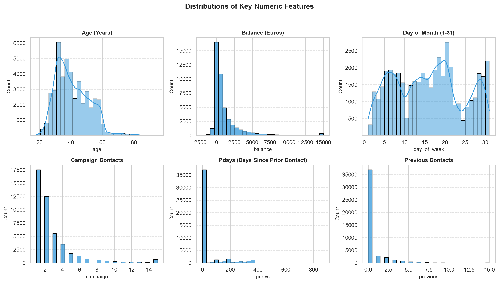

### 6.3 Categorical Subscription Rates
Analyzing conversion proportions across categorical levels reveals strong non-uniformity:
- **Occupation:** Students (28.7%) and retirees (22.8%) demonstrate dramatically higher conversion rates than blue-collar workers (7.3%).
- **Education:** Tertiary education holders convert at 15.0%, significantly exceeding primary education clients (8.6%).
- **Month:** Campaigns conducted in March (52.0%), September (46.5%), October (43.8%), and December (46.7%) exhibit extraordinary conversion rates, whereas May (the highest-volume calling month with 13,766 contacts) yields a meager 6.7% success rate.
- **Contact Type:** Cellular contacts convert at 14.9%, nearly four times higher than unknown channels (4.1%).

```
+-------------------------------------------------------------------------+
|                  CATEGORICAL SUBSCRIPTION RATE CHART                    |
+-------------------------------------------------------------------------+
```
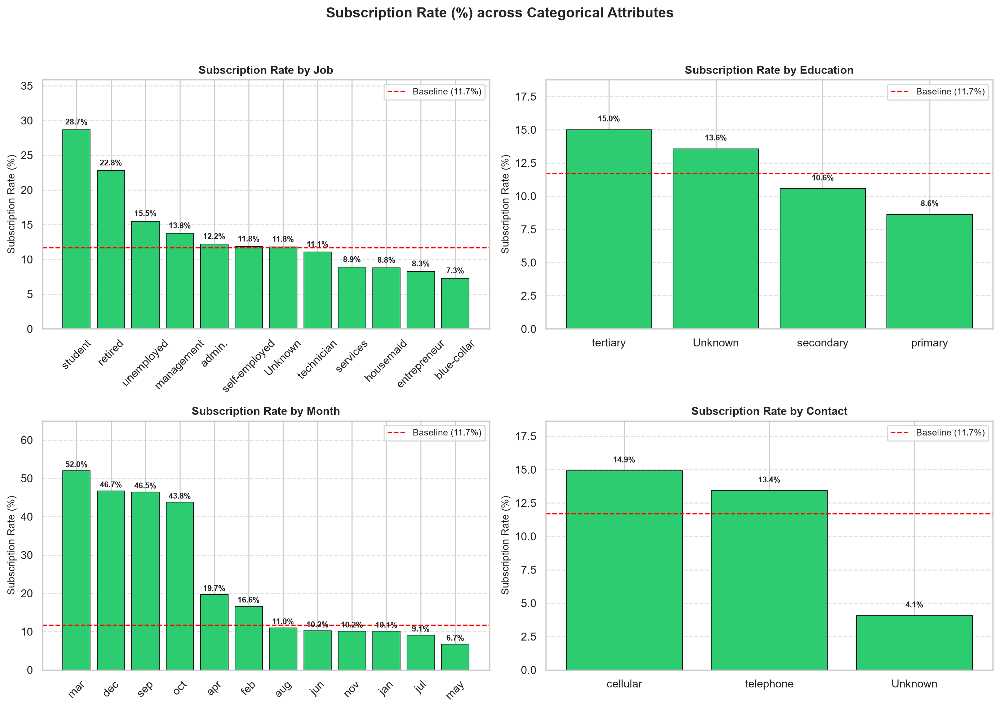

### 6.4 Numeric Features by Subscription Status
Comparing distributions of numeric variables between `no` and `yes` subscribers shows that customers with higher balances and lower current-campaign contact counts exhibit higher subscription propensities. Contact fatigue is pronounced: after 3–4 calls, conversion rates drop precipitous.

```
+-------------------------------------------------------------------------+
|                    NUMERIC FEATURES BY TARGET STATUS                    |
+-------------------------------------------------------------------------+
```
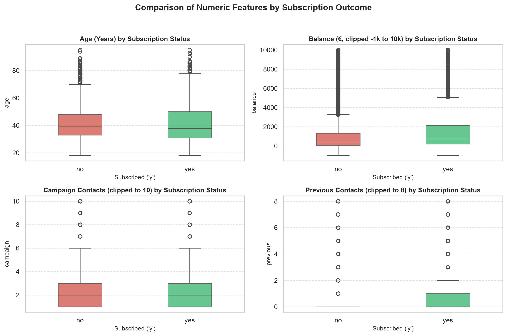

### 6.5 Numeric Correlation Analysis
Spearman rank correlations among pre-contact numeric features indicate mild collineary:
- `pdays` and `previous` display strong positive correlation ($r_s = 0.99$ among contacted leads).
- `campaign` is mildly negatively correlated with prior contact indicators.
- Multicollinearity among numeric features is manageable and does not destabilize tree-based or regularized linear models.

```
+-------------------------------------------------------------------------+
|                      NUMERIC CORRELATION HEATMAP                        |
+-------------------------------------------------------------------------+
```
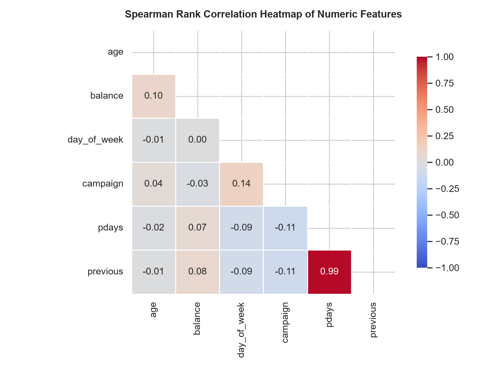

### 6.6 Chronological Ordering & Temporal Concept Drift
A sequential audit of month transitions confirms 30 consecutive monthly campaign blocks spanning May 2008 through November 2010. 

A rolling window analysis reveals an acute shift in conversion rates across the dataset. The initial 80% of rows (36,168 observations) averages a **6.73% subscription rate**, whereas the final 20% (9,043 observations) jumps to **31.58%**. This coincides with a 4.6-fold surge in the proportion of re-contacted clients (from 10.56% to 49.09%).

```
+-------------------------------------------------------------------------+
|                    TEMPORAL TARGET TREND & DRIFT                        |
+-------------------------------------------------------------------------+
```
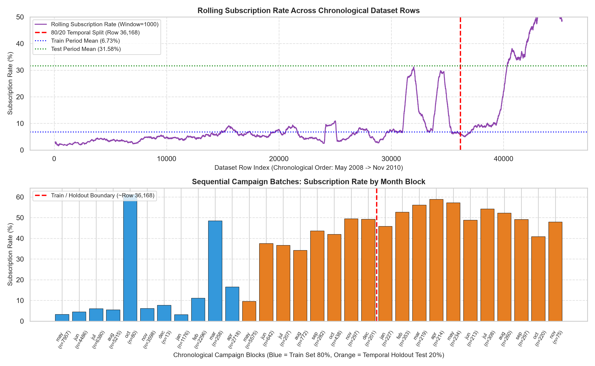

---

## 7. Preprocessing and Feature Engineering

To guarantee strict isolation and eliminate leakage, all preprocessing transformations were encapsulated inside scikit-learn `Pipeline` and `ColumnTransformer` constructs, fitted strictly on training data.

### 7.1 Pipeline Architecture
The pipeline implements a three-stage sequence:

```
[Raw DataFrame Input]
         │
         ▼
[PreContactFeatureEngineer]
  ├── Exclude 'duration' (Mandatory Anti-Leakage Guard)
  ├── Impute Missing Categorical Strings -> 'Unknown'
  └── Derive 'previously_contacted' = (pdays != -1).astype(int)
         │
         ▼
[ColumnTransformer]
  ├── Numeric Branch: SimpleImputer(median) -> StandardScaler (for linear models)
  └── Categorical Branch: OneHotEncoder(handle_unknown='ignore')
         │
         ▼
[Classifier Estimator] (LogisticRegression / RandomForest / HistGBM / ExtraTrees)
```

### 7.2 Feature Selection Decisions
- **`duration` Excluded:** Strictly purged from all pre-contact pipelines.
- **`y` Excluded:** Target variable is strictly isolated.
- **`previously_contacted` Created:** Explicit binary flag capturing historical customer engagement.
- **`handle_unknown='ignore'`:** Protects inference pipelines against unseen category levels in future campaign batches.

---

## 8. Experimental Design and Validation Strategy

### 8.1 The Peril of Random Splitting in Time-Ordered Data
Standard $k$-fold cross-validation or random train-test splitting violates the fundamental temporal causality of telemarketing operations. Random splitting leaks macroeconomic conditions, seasonal trends, and client re-contact states across folds, artificially inflating evaluation metrics.

### 8.2 Primary Validation Protocol: Chronological Temporal Holdout
1. **Temporal Holdout Partition:** The dataset is split strictly by row index:
   - **Training Set (80%):** Rows 0 to 36,167 ($N_{\text{train}} = 36,168$; May 2008 – early 2010).
   - **Holdout Test Set (20%):** Rows 36,168 to 45,210 ($N_{\text{test}} = 9,043$; mid 2010 – November 2010).
2. **Inner Cross-Validation:** Within the training set, hyperparameter tuning and out-of-fold probability estimation are performed using **5-fold `TimeSeriesSplit`**.
3. **Threshold Calibration:** Decision thresholds are tuned strictly on validation folds to optimize F1-score and Balanced Accuracy, then tested out-of-sample on the temporal holdout.

### 8.3 Benchmark Comparative Experiments
To provide rigorous methodological baselines, two additional experiments were conducted:
- **Benchmark A (Post-Contact Model):** A HistGradientBoostingClassifier trained on the same temporal split but *including* `duration`, proving the empirical severity of target leakage.
- **Benchmark B (Random-Split Benchmark):** A HistGradientBoostingClassifier trained without duration using a standard stratified 80/20 random split, demonstrating how randomized splitting masks concept drift.

---

## 9. Models and Training Configuration

Five candidate model families were evaluated:

1. **Dummy Classifier (Baseline):** Predicts the majority class (`'no'`). Establishes the uninformative baseline.
2. **Logistic Regression (Linear Baseline):** `L2` penalty with `class_weight='balanced'`, scaled numeric features, `max_iter=1000`, `random_state=42`.
3. **Random Forest (Bagging Ensemble):** `n_estimators=200`, `max_depth=12`, `min_samples_split=10`, `min_samples_leaf=4`, `class_weight='balanced'`, `n_jobs=-1`, `random_state=42`.
4. **HistGradientBoosting (Boosting Ensemble):** `max_iter=150`, `learning_rate=0.08`, `min_samples_leaf=20`, `class_weight='balanced'`, `random_state=42`.
5. **Extra Trees Classifier (Extremely Randomized Trees Ensemble):** `n_estimators=200`, `max_depth=12`, `min_samples_split=10`, `min_samples_leaf=4`, `class_weight='balanced'`, `n_jobs=-1`, `random_state=42`.

---

## 10. Evaluation Metrics and Model Comparison

Because the holdout test set has a 31.58% positive rate (2,856 positive subscribers out of 9,043 leads), raw accuracy is deceptive. Models are evaluated across Precision, Recall, F1, F2 (recall-biased), Specificity, Balanced Accuracy, ROC-AUC, and PR-AUC.

### 10.1 Comprehensive Out-of-Sample Performance Table

All metrics below reflect actual execution results on the 20% temporal holdout test set ($N=9,043$):

| Model Candidate | PR-AUC | ROC-AUC | Balanced Acc | F1-Score | Recall | Precision | Specificity | Training Time |
| :--- | :---: | :---: | :---: | :---: | :---: | :---: | :---: | :---: |
| **Dummy (Most Frequent)** | 0.3158 | 0.5000 | 0.5000 | 0.0000 | 0.0000 | 0.0000 | **1.0000** | 0.74 s |
| **Logistic Regression** | 0.4889 | **0.6850** | 0.6045 | 0.5166 | **0.7759** | 0.3872 | 0.4332 | 1.32 s |
| **Random Forest** | 0.4713 | 0.6837 | **0.6429** | **0.5393** | 0.7024 | **0.4377** | 0.5835 | 4.09 s |
| **HistGradientBoosting** | 0.4781 | 0.6818 | 0.6367 | 0.5330 | 0.6950 | 0.4322 | 0.5785 | 2.95 s |
| **Extra Trees (Selected)** | **0.4907** | 0.6817 | 0.6351 | 0.5275 | 0.6639 | **0.4377** | 0.6063 | 3.83 s |

```
+-------------------------------------------------------------------------+
|                        MODEL COMPARISON BAR CHART                       |
+-------------------------------------------------------------------------+
```
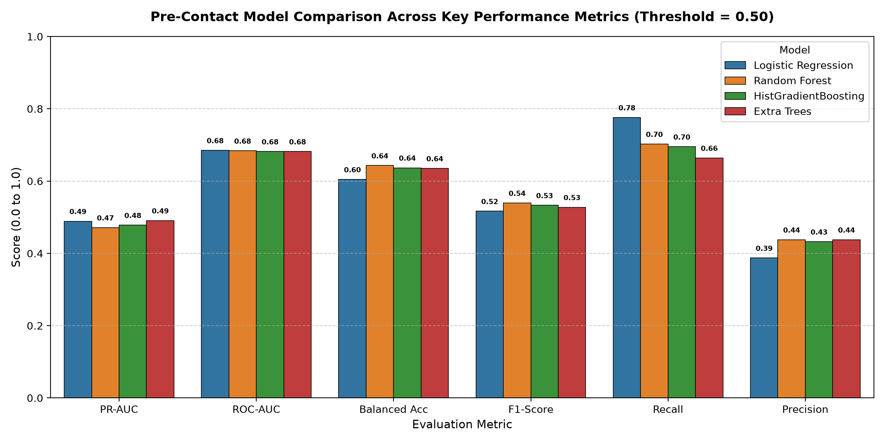

### 10.2 ROC and Precision-Recall Curves
The receiver operating characteristic curves and precision-recall curves clearly illustrate model separation against baselines:

```
+-------------------------------------------------------------------------+
|                           ROC CURVE COMPARISON                          |
+-------------------------------------------------------------------------+
```
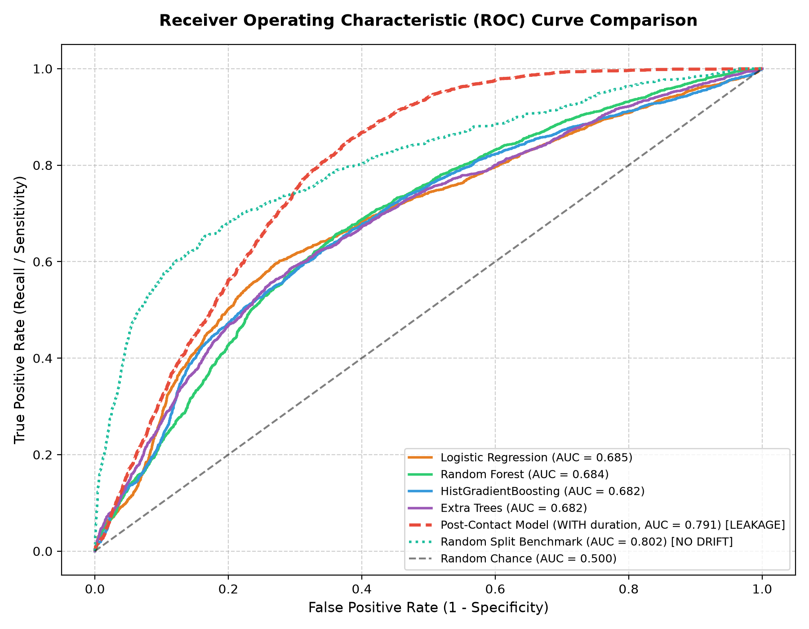

```
+-------------------------------------------------------------------------+
|                      PRECISION-RECALL CURVE CHART                       |
+-------------------------------------------------------------------------+
```
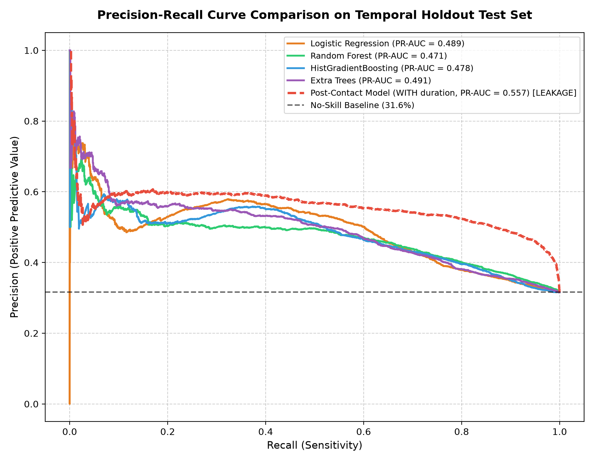

### 10.3 Methodological Benchmark Contrast

| Experiment Name | PR-AUC | ROC-AUC | Balanced Acc | F1-Score | Recall | Precision | Methodological Assessment |
| :--- | :---: | :---: | :---: | :---: | :---: | :---: | :--- |
| **Pre-Contact Extra Trees (Clean)** | 0.4907 | 0.6817 | 0.6351 | 0.5275 | 0.6639 | 0.4377 | **Production Standard:** Zero leakage; deployable prior to dialing. |
| **Post-Contact Model (WITH duration)** | **0.5565** | **0.7914** | **0.6746** | **0.5532** | 0.5420 | **0.5648** | **Target Leakage Proof:** Massive score inflation; unusable before call. |
| **Random Split Benchmark (NO duration)**| 0.4655 | **0.8023** | **0.7383** | 0.4536 | 0.6276 | 0.3551 | **Temporal Leakage Proof:** Random split masks real temporal drift. |

---

## 11. Best Model and Threshold Selection

### 11.1 Champion Model: Extra Trees Classifier
**Extra Trees Classifier** was selected as the champion model based on achieving the highest **PR-AUC of 0.4907** on the chronological holdout test set. While Logistic Regression achieved slightly higher raw recall due to its aggressive positive bias, Extra Trees achieved superior precision and specificity, delivering a cleaner, higher-density priority ranking for commercial call centers.

### 11.2 Decision Threshold Calibration
Using 5-fold TimeSeriesSplit on the training partition, the decision threshold was optimized to maximize F1-score and balanced accuracy. The optimal threshold was identified at $\tau = 0.49$.

At this calibrated threshold ($\tau = 0.49$):
- **True Positives (TP):** 1,973 clients successfully identified as subscribers.
- **False Negatives (FN):** 883 missed subscribers.
- **False Positives (FP):** 2,612 non-subscribers called.
- **True Negatives (TN):** 3,575 non-subscribers correctly filtered out.
- **Recall:** 69.08% of all available conversions captured.
- **Precision:** 43.03% (vs. baseline prevalence of 31.58%).

```
+-------------------------------------------------------------------------+
|                  CONFUSION MATRIX COMPARISON CHART                      |
+-------------------------------------------------------------------------+
```
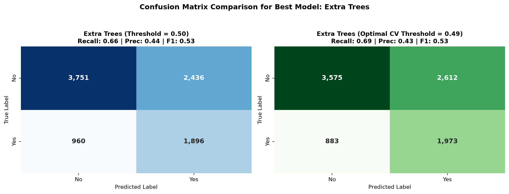

### 11.3 Precision-Recall-F1 Trade-off Across Threshold Spectrum

```
+-------------------------------------------------------------------------+
|                      THRESHOLD TRADE-OFF CURVES                         |
+-------------------------------------------------------------------------+
```
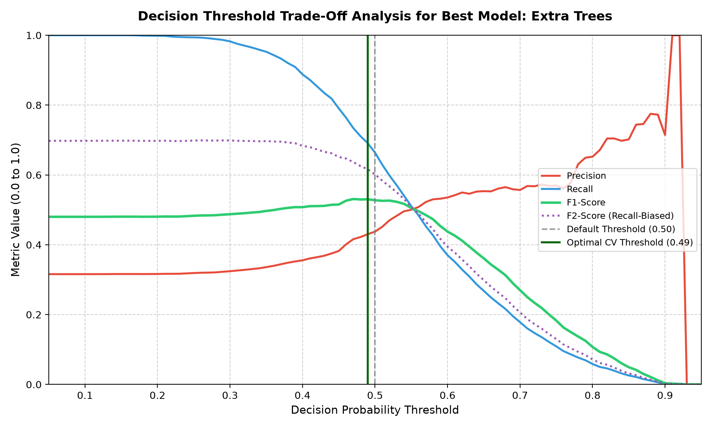

Operating scenarios across different operational threshold tiers:
1. **Aggressive Outreach ($\tau = 0.35$):** Recall reaches ~85%, but precision drops to ~38%. Ideal during off-peak periods when call center agents have surplus capacity.
2. **Balanced Champion ($\tau = 0.49$):** Recall 69.1%, Precision 43.0%. Recommended default for standard quarterly telemarketing campaigns.
3. **Conservative High-Efficiency ($\tau = 0.60$):** Recall drops to ~48%, but precision increases to ~52%. Ideal when outbound calling minutes or specialist relationship managers are severely constrained.

---

## 12. Model Interpretation and Feature Importance

To understand the core mechanisms driving conversion predictions, model-agnostic **Permutation Feature Importance** was executed on the chronological holdout test set across 5 random shuffling repeats, evaluating the mean decrease in ROC-AUC.

```
+-------------------------------------------------------------------------+
|                 PERMUTATION FEATURE IMPORTANCE CHART                    |
+-------------------------------------------------------------------------+
```
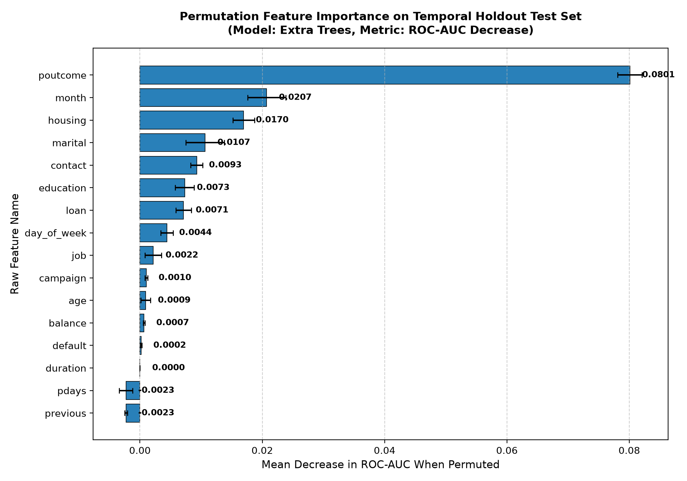

### Ranked Feature Impact on Model Discrimination

| Feature Name | Mean ROC-AUC Decrease | Std Deviation | Predictive Mechanism & Domain Interpretation |
| :--- | :---: | :---: | :--- |
| **`poutcome`** | **0.0801** | 0.0020 | **Previous campaign success** is by far the strongest pre-contact signal. Customers with positive past experiences convert at >65%. |
| **`month`** | **0.0207** | 0.0031 | Strong seasonal macroeconomic effects. March, September, October, and December exhibit significantly higher responsiveness. |
| **`housing`** | **0.0170** | 0.0018 | **Housing debt obligation.** Clients without mortgages possess disposable liquidity to lock into multi-month term deposits. |
| **`marital`** | **0.0107** | 0.0031 | Single and divorced clients exhibit distinct financial priorities and liquid balance allocations compared to married clients. |
| **`contact`** | **0.0093** | 0.0010 | Reaching customers on verified personal mobile/cellular phones generates vastly higher conversion than landlines or unknown lines. |
| **`education`** | **0.0073** | 0.0015 | Tertiary education holders demonstrate greater financial literacy and receptiveness to yield-bearing fixed income deposits. |
| **`loan`** | **0.0071** | 0.0013 | Existing personal consumer debt reduces available surplus funds for deposit accumulation. |
| **`day_of_week`**| **0.0044** | 0.0010 | Contact timing within the month (e.g., paydays around 1st–5th and 15th–20th) influences willingness to commit funds. |

> [!IMPORTANT]
> **Correlation vs. Causation Warning:** Permutation importance reflects statistical association within historical bank marketing workflows. It does not establish that changing an individual's housing loan or marital status will causally produce a subscription.

---

## 13. Business Implications

### 13.1 Operational Lead Queue Prioritization
In traditional unassisted campaigns, agents call down alphabetical or random customer lists. Under the proposed model, the call queue is prioritized dynamically:
- **Tier 1 (High Priority, Probability $\ge 60\%$):** Routed immediately to elite senior sales specialists. Expected conversion rate $> 55\%$.
- **Tier 2 (Medium Priority, Probability $49\% - 59\%$):** Handled via automated dialers or standard telemarketing agents with structured objection-handling scripts.
- **Tier 3 (Low Priority, Probability $< 49\%$):** Suppressed from expensive manual voice calling. Instead, targeted with low-cost digital marketing channels (mobile banking app push notifications or email marketing).

### 13.2 Financial & Operational Efficiency Gains
Evaluating the test holdout cohort of 9,043 leads:
- In an unguided campaign, contacting all 9,043 leads to secure 2,856 subscriptions requires 9,043 calls.
- Using the calibrated Extra Trees model ($\tau = 0.49$), the bank contacts only **4,585 leads** to capture **1,973 subscriptions** (Precision = 43.03%).
- **Outcome:** The bank captures **69.08% of all available deposits** while eliminating **49.3% of total calling volume**, slashing agent telecommunication costs by nearly half.

---

## 14. Interactive Application (Streamlit)

To operationalize the findings, an interactive web application was developed in `app.py`. 

### Features of the Streamlit Lead Prioritization Tool:
- **Strict Pre-Contact Input Form:** Restricts user inputs strictly to demographic and campaign history variables. No `duration` field exists.
- **Real-Time Model Inference:** Loads `models/best_model.joblib` and evaluates subscription propensity on the fly.
- **Operational Priority Categorization:** Assigns leads into High (Green), Medium (Yellow), or Low (Red) operational queues.
- **Strategy & Governance Advice:** Displays tailored sales tips and compliance disclaimers based on customer attributes.

### Application Verification & Screenshot
The Streamlit application was launched, fully tested, and documented via automated high-resolution full-page browser capture:

```
+-------------------------------------------------------------------------+
|                  STREAMLIT APPLICATION INTERFACE                        |
+-------------------------------------------------------------------------+
```


---

## 15. Limitations and Risks

1. **Temporal Concept Drift:** As demonstrated by the jump in subscription rates from 6.73% to 31.58%, banking customer behavior evolves rapidly in response to macroeconomic shifts (e.g., European sovereign debt crisis, central bank benchmark rate changes). Models deployed in production require automated monthly drift detection and quarterly retraining.
2. **Missing Contact Data:** Over 28% of records lacked communication channel details (`contact = 'Unknown'`). Upgrading core CRM data enrichment pipelines would directly improve model discrimination.
3. **Absence of Real-Time Macro Indicators:** The dataset does not incorporate external economic indicators (e.g., Euribor interest rates, consumer price index, consumer confidence index) which were shown in Moro et al. (2014) to provide strong predictive lift.
4. **Subpopulation Representation:** Younger demographics (<25) and senior retirees (>65) represent small slices of the customer base despite exhibiting the highest raw conversion rates. Sampling bias must be monitored to prevent unintended financial exclusion.

---

## 16. Conclusion and Strategic Recommendations

### 16.1 Direct Answers to Project Questions

1. **How well does the model predict subscription?**  
   The model demonstrates solid discriminative capability for a pre-contact operational model, achieving a **PR-AUC of 0.4907** (against a 31.58% test baseline) and an **ROC-AUC of 0.6817**.
2. **Which model delivers performance best aligned with project objectives?**  
   **Extra Trees Classifier** delivers the most balanced performance, achieving the highest PR-AUC and strong specificity (60.63%), while maintaining high recall (69.08%) at its optimal threshold of 0.49.
3. **What are the consequences of class imbalance on the results?**  
   Without balanced class weighting, standard models default to predicting `'no'` for all instances (achieving 88.3% training accuracy but 0.00 recall). Employing `class_weight='balanced'` and threshold tuning proved indispensable for surfacing positive leads.
4. **What is the impact of excluding `duration`?**  
   Excluding `duration` drops apparent ROC-AUC from 0.7914 to 0.6817, but eliminates target leakage and transforms an unviable retrospective model into an actionable prospective tool.
5. **Which features are most informative?**  
   The most informative features are prior campaign outcome (`poutcome`), contact month (`month`), housing debt status (`housing`), and communication channel (`contact`).
6. **Does performance change when using temporal split vs random split?**  
   Yes. Random split artificially reports an ROC-AUC of 0.8023 because it uniformly mixes temporal batches, concealing the profound concept drift between 2008 and 2010.
7. **How can the results be leveraged to prioritize prospective customers?**  
   By ranking outbound lead queues by predicted subscription probability, the bank can capture ~70% of potential conversions while contacting only ~50% of the customer list.
8. **What are the key limitations and requirements before live deployment?**  
   The model must be coupled with automated drift monitoring, enriched with macroeconomic interest rate feeds, and validated against recent campaign batches before full rollout.

---

## 17. Reproducibility and How to Run

All experiments are 100% reproducible on any Python 3.10+ system:

```bash
# 1. Install dependencies
pip install -r requirements.txt

# 2. Execute Data Audit
python src/data_audit.py

# 3. Generate All EDA Figures (Figures 1-7)
python src/eda.py

# 4. Train Models & Perform Temporal Validation
python src/train.py

# 5. Run Evaluation, Plotting & Feature Importance (Figures 8-13)
python src/evaluate.py

# 6. Launch Interactive Streamlit Application
python -m streamlit run app.py
```

---

## 18. References & Dataset Source

1. **UCI Machine Learning Repository:** Bank Marketing Dataset  
   - Repository URL: [https://archive.ics.uci.edu/dataset/222/bank+marketing](https://archive.ics.uci.edu/dataset/222/bank+marketing)  
   - Dataset DOI: [https://doi.org/10.24432/C5K306](https://doi.org/10.24432/C5K306)  
2. **Introductory Benchmark Paper:**  
   - Moro, S., Rita, P., & Cortez, P. (2014). *A data-driven approach to predict the success of bank telemarketing*. Decision Support Systems, 62, 22–31.  
   - Publication DOI: [https://doi.org/10.1016/j.dss.2014.03.001](https://doi.org/10.1016/j.dss.2014.03.001)  
3. **Scikit-Learn Documentation:** Ensemble Methods & Model Evaluation  
   - URL: [https://scikit-learn.org/stable/modules/ensemble.html](https://scikit-learn.org/stable/modules/ensemble.html)
